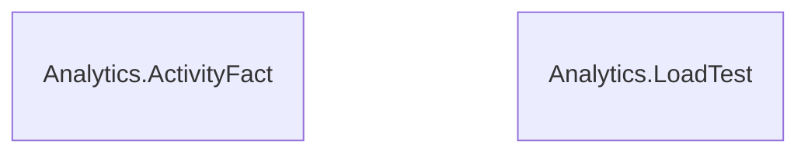

# Analytics schema

The `Analytics` schema has 2 tables and 7,805,406 rows. Back to the [schema overview](README.md).

## Entity-relationship diagram

Primary and foreign key columns only. Tables of other schemas appear when a table of this schema references them. A line is drawn from the referenced table to the referencing table: two bars mean exactly one parent, a circle and a bar mean at most one parent (nullable foreign key), and the crow's foot means any number of rows.

## Tables

### Analytics.ActivityFact

Copy of Elearning.Activity stored in an ordered clustered columnstore index on EventTime, with the session, course and location copied onto each row for aggregates and window functions; it has no ActivityId.

Rows: 7,805,406. Columns: 12.

| Column | Type | Nullable | Key | Default | Description |
|---|---|---|---|---|---|
| `EventTime` | `datetime2(0)` | no |  |  | Date and time of the event, to the second. |
| `ContactId` | `int` | no |  |  | Contact (learner) who produced the event. |
| `EnrollmentId` | `int` | no |  |  | Enrollment the event belongs to. |
| `SessionId` | `int` | no |  |  | Session of the enrollment, copied from the enrollment so aggregates need no join. |
| `CourseId` | `int` | no |  |  | Course of the session, copied for the same reason. |
| `TrainingLocationId` | `int` | no |  |  | Training location of the session's room, copied for the same reason (the virtual classroom is a location). |
| `ModuleId` | `int` | yes |  |  | E-learning module concerned, or NULL for login, logout and virtual classroom events. |
| `EventTypeCode` | `char(4)` | no |  |  | Event type code: CONN, DECO, OUVR, PAGE, VIDE, QUIZ, FINM or CVIR (login, logout, module opened, page read, video watched, quiz submitted, module completed, virtual classroom attendance). Codes are kept as in the French source and are not translated. |
| `Step` | `smallint` | yes |  |  | Rank of the page or video inside the module (1 to the module's step count), set only for page and video events. |
| `DurationSeconds` | `int` | yes |  |  | Duration of the page, video or virtual classroom attendance in seconds, NULL for the other event types. |
| `Score` | `tinyint` | yes |  |  | Quiz score from 0 to 100, set only for quiz events. |
| `Device` | `char(1)` | no |  |  | Device code: O (desktop or laptop computer), T (tablet) or M (mobile). Codes are kept as in the French source and are not translated. |

### Analytics.LoadTest

Empty copy of ActivityFact with the same columnstore structure, used to try the bulk load threshold of 102,400 rows per batch.

Rows: 0. Columns: 12.

| Column | Type | Nullable | Key | Default | Description |
|---|---|---|---|---|---|
| `EventTime` | `datetime2(0)` | no |  |  | Date and time of the event, to the second. |
| `ContactId` | `int` | no |  |  | Contact (learner) who produced the event. |
| `EnrollmentId` | `int` | no |  |  | Enrollment the event belongs to. |
| `SessionId` | `int` | no |  |  | Session of the enrollment, copied from the enrollment so aggregates need no join. |
| `CourseId` | `int` | no |  |  | Course of the session, copied for the same reason. |
| `TrainingLocationId` | `int` | no |  |  | Training location of the session's room, copied for the same reason (the virtual classroom is a location). |
| `ModuleId` | `int` | yes |  |  | E-learning module concerned, or NULL for login, logout and virtual classroom events. |
| `EventTypeCode` | `char(4)` | no |  |  | Event type code: CONN, DECO, OUVR, PAGE, VIDE, QUIZ, FINM or CVIR (login, logout, module opened, page read, video watched, quiz submitted, module completed, virtual classroom attendance). Codes are kept as in the French source and are not translated. |
| `Step` | `smallint` | yes |  |  | Rank of the page or video inside the module (1 to the module's step count), set only for page and video events. |
| `DurationSeconds` | `int` | yes |  |  | Duration of the page, video or virtual classroom attendance in seconds, NULL for the other event types. |
| `Score` | `tinyint` | yes |  |  | Quiz score from 0 to 100, set only for quiz events. |
| `Device` | `char(1)` | no |  |  | Device code: O (desktop or laptop computer), T (tablet) or M (mobile). Codes are kept as in the French source and are not translated. |

## Foreign keys

No table of this schema has a foreign key.
