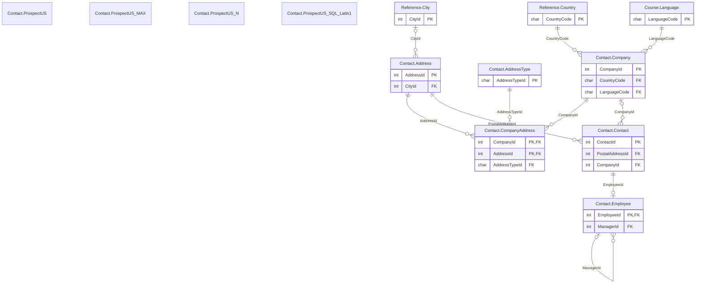

# Contact schema

The `Contact` schema has 10 tables and 4,358,314 rows. Back to the [schema overview](README.md).

## Entity-relationship diagram

Primary and foreign key columns only. Tables of other schemas appear when a table of this schema references them. A line is drawn from the referenced table to the referencing table: two bars mean exactly one parent, a circle and a bar mean at most one parent (nullable foreign key), and the crow's foot means any number of rows.

## Tables

### Contact.Address

Postal addresses of contacts, companies and trainer companies; several rows of other tables can point to the same address.

Rows: 128,183. Columns: 5.

| Column | Type | Nullable | Key | Default | Description |
|---|---|---|---|---|---|
| `AddressId` | `int` | no | PK, identity |  | Address identifier, generated automatically. |
| `CityId` | `int` | yes | FK to Reference.City |  | City of the address, in Reference.City. |
| `Address1` | `varchar(50)` | no |  |  | Street line of the address. |
| `Address2` | `varchar(50)` | yes |  |  | Second address line; NULL for almost every row. |
| `IsValid` | `bit` | no |  | `1` | 1 when the address is valid; the value is 1 on every row. |

### Contact.AddressType

Reference table of address types.

Rows: 3. Columns: 2.

| Column | Type | Nullable | Key | Default | Description |
|---|---|---|---|---|---|
| `AddressTypeId` | `char(1)` | no | PK |  | Address type code: M (mailing), B (billing) or P (main). |
| `Label` | `varchar(20)` | no |  |  | Display name of the address type. |

### Contact.Company

Client companies, about 2,000 fictitious companies in ten countries.

Rows: 2,000. Columns: 14.

| Column | Type | Nullable | Key | Default | Description |
|---|---|---|---|---|---|
| `CompanyId` | `int` | no | PK, identity |  | Company identifier, generated automatically. |
| `Name` | `varchar(60)` | no |  |  | Company name. |
| `VatNumber` | `varchar(30)` | yes |  |  | VAT number in the format of the country; NULL for administrations and for some foreign companies. |
| `ReminderType` | `smallint` | no |  | `0` | Reminder setting for unpaid invoices: 0, 1 or 2; the meaning of each value is not documented. |
| `InvoiceBeforeEnrollment` | `bit` | no |  | `0` | 1 when the company is invoiced and settles the invoice before the course (about 10 percent of the companies, mostly administrations). |
| `Phone2` | `varchar(30)` | yes |  |  | Second phone number; NULL for about 70 percent of the companies. |
| `Phone1` | `varchar(30)` | yes |  |  | Main phone number. |
| `Discount` | `tinyint` | no |  | `0` | Discount percentage applied to the company's invoices, from 0 to 15. |
| `CountryCode` | `char(3)` | no | FK to Reference.Country |  | Country, as a three-letter ISO 3166 code (FRA, BEL, CHE, DEU, ITA, LUX, NLD, ESP, GBR, USA). |
| `Sector` | `varchar(50)` | yes |  |  | Business sector, 22 distinct values. |
| `Siren` | `char(9)` | yes |  |  | French company registration number (9 digits); NULL for foreign companies and some French ones. |
| `CreationDate` | `date` | yes |  |  | Date the company was created. |
| `EmailDomain` | `varchar(100)` | no |  |  | Domain used by the e-mail addresses of the company's contacts; unique. |
| `LanguageCode` | `char(2)` | no | FK to Course.Language |  | Correspondence language, an ISO 639-1 code (FR, EN, DE or IT). |

### Contact.CompanyAddress

Addresses of a company by type: every company has a main address and about one in five has a distinct billing address.

Rows: 2,408. Columns: 3.

| Column | Type | Nullable | Key | Default | Description |
|---|---|---|---|---|---|
| `CompanyId` | `int` | no | PK, FK to Contact.Company |  | Company, in Contact.Company. |
| `AddressId` | `int` | no | PK, FK to Contact.Address |  | Address, in Contact.Address. |
| `AddressTypeId` | `char(1)` | no | FK to Contact.AddressType | `'P'` | Address type code, in Contact.AddressType: P (main) or B (billing). |

### Contact.Contact

People known to the company: learners, company employees and trainers, about 120,000 rows with names, e-mail addresses and phone numbers invented by a generator.

Rows: 120,140. Columns: 12.

| Column | Type | Nullable | Key | Default | Description |
|---|---|---|---|---|---|
| `ContactId` | `int` | no | PK, identity |  | Contact identifier, generated automatically. |
| `Title` | `varchar(3)` | yes |  |  | Courtesy title: Mr. or Ms.; a free text column with no foreign key, consistent with Gender. |
| `LastName` | `varchar(50)` | no |  |  | Family name. |
| `FirstName` | `varchar(50)` | yes |  |  | Given name. |
| `Email` | `varchar(150)` | yes |  |  | E-mail address, usually at the domain of the company; NULL for about 10 percent of the contacts. |
| `Phone` | `varchar(15)` | yes |  |  | Landline number, stored as digits without spaces. |
| `Fax` | `varchar(15)` | yes |  |  | Fax number; set for about 5 percent of the contacts. |
| `Gender` | `varchar(1)` | yes |  |  | Gender code: M or F. |
| `Mobile` | `varchar(15)` | yes |  |  | Mobile phone number; NULL for about a quarter of the contacts. |
| `PostalAddressId` | `int` | no | FK to Contact.Address |  | Personal postal address, in Contact.Address. |
| `CompanyId` | `int` | yes | FK to Contact.Company |  | Employer, in Contact.Company; NULL for contacts without a company. |
| `BirthDate` | `date` | yes |  |  | Date of birth, between 1950 and 2007. |

### Contact.Employee

Organization chart of the client companies, one row per contact of a company who is not a trainer; the reporting line is a self-reference used for recursive queries.

Rows: 105,580. Columns: 5.

| Column | Type | Nullable | Key | Default | Description |
|---|---|---|---|---|---|
| `EmployeeId` | `int` | no | PK, FK to Contact.Contact |  | Contact identifier of the employee, also the primary key. |
| `ManagerId` | `int` | yes | FK to Contact.Employee |  | Employee identifier of the manager in the same company; NULL for the head of the company (one per company). |
| `Department` | `char(4)` | no |  |  | Department code: EXEC, IT, FIN, SALE, HR, PROD or LEGL. |
| `JobTitle` | `varchar(100)` | no |  |  | Job title, written in the language of the company. |
| `HireDate` | `date` | no |  |  | Date the employee joined the company. |

### Contact.ProspectUS

One million fictitious US prospects, stored as a heap with varchar columns; the reference table for the prospect demonstrations.

Rows: 1,000,000. Columns: 8.

| Column | Type | Nullable | Key | Default | Description |
|---|---|---|---|---|---|
| `FirstName` | `varchar(50)` | yes |  |  | Given name of the prospect. |
| `LastName` | `varchar(50)` | no |  |  | Family name of the prospect. |
| `Address` | `varchar(50)` | no |  |  | Street address in the United States. |
| `ZipCode` | `varchar(20)` | yes |  |  | US ZIP code stored as text, with its leading zero; NULL for about 1 percent of the rows. |
| `City` | `varchar(255)` | yes | collation French_CI_AI |  | US city. |
| `Phone` | `varchar(50)` | yes |  |  | Phone number in several formats; NULL for about 1 percent of the rows. |
| `Email` | `varchar(100)` | yes |  |  | E-mail address; NULL for about 1 percent of the rows. |
| `IsContact` | `bit` | no |  | `0` | 1 when the prospect has become a contact; 0 on every row. |

### Contact.ProspectUS_MAX

The same one million prospects with every text column declared varchar(max), to show what the declared length costs.

Rows: 1,000,000. Columns: 7.

| Column | Type | Nullable | Key | Default | Description |
|---|---|---|---|---|---|
| `FirstName` | `varchar(max)` | yes |  |  | Given name of the prospect. |
| `LastName` | `varchar(max)` | no |  |  | Family name of the prospect. |
| `Address` | `varchar(max)` | no |  |  | Street address in the United States. |
| `ZipCode` | `varchar(max)` | yes |  |  | US ZIP code stored as text, with its leading zero; NULL for about 1 percent of the rows. |
| `City` | `varchar(max)` | yes |  |  | US city. |
| `Phone` | `varchar(max)` | yes |  |  | Phone number in several formats; NULL for about 1 percent of the rows. |
| `Email` | `varchar(max)` | yes |  |  | E-mail address; NULL for about 1 percent of the rows. |

### Contact.ProspectUS_N

The same one million prospects with nvarchar columns, to compare the size of Unicode and non-Unicode storage.

Rows: 1,000,000. Columns: 7.

| Column | Type | Nullable | Key | Default | Description |
|---|---|---|---|---|---|
| `FirstName` | `nvarchar(50)` | yes |  |  | Given name of the prospect. |
| `LastName` | `nvarchar(50)` | no |  |  | Family name of the prospect. |
| `Address` | `nvarchar(50)` | no |  |  | Street address in the United States. |
| `ZipCode` | `nvarchar(20)` | yes |  |  | US ZIP code stored as text, with its leading zero; NULL for about 1 percent of the rows. |
| `City` | `nvarchar(255)` | yes |  |  | US city. |
| `Phone` | `nvarchar(50)` | yes |  |  | Phone number in several formats; NULL for about 1 percent of the rows. |
| `Email` | `nvarchar(100)` | yes |  |  | E-mail address; NULL for about 1 percent of the rows. |

### Contact.ProspectUS_SQL_Latin1

The same one million prospects with the columns in the collation SQL_Latin1_General_CP1_CI_AS instead of the database collation, to compare collation behavior.

Rows: 1,000,000. Columns: 7.

| Column | Type | Nullable | Key | Default | Description |
|---|---|---|---|---|---|
| `FirstName` | `varchar(50)` | yes | collation SQL_Latin1_General_CP1_CI_AS |  | Given name of the prospect. |
| `LastName` | `varchar(50)` | no | collation SQL_Latin1_General_CP1_CI_AS |  | Family name of the prospect. |
| `Address` | `varchar(50)` | no | collation SQL_Latin1_General_CP1_CI_AS |  | Street address in the United States. |
| `ZipCode` | `varchar(20)` | yes | collation SQL_Latin1_General_CP1_CI_AS |  | US ZIP code stored as text, with its leading zero; NULL for about 1 percent of the rows. |
| `City` | `varchar(255)` | yes | collation SQL_Latin1_General_CP1_CI_AS |  | US city. |
| `Phone` | `varchar(50)` | yes | collation SQL_Latin1_General_CP1_CI_AS |  | Phone number in several formats; NULL for about 1 percent of the rows. |
| `Email` | `varchar(100)` | yes | collation SQL_Latin1_General_CP1_CI_AS |  | E-mail address; NULL for about 1 percent of the rows. |

## Foreign keys

Indexed means that a rowstore index starts with the foreign key columns.

| Name | Table | Columns | References | Indexed |
|---|---|---|---|---|
| `fk_Address_City` | Contact.Address | `CityId` | Reference.City | no |
| `fk_Company_Country` | Contact.Company | `CountryCode` | Reference.Country | no |
| `fk_Company_Language` | Contact.Company | `LanguageCode` | Course.Language | no |
| `fk_CompanyAddress_Address` | Contact.CompanyAddress | `AddressId` | Contact.Address | no |
| `fk_CompanyAddress_AddressType` | Contact.CompanyAddress | `AddressTypeId` | Contact.AddressType | no |
| `fk_CompanyAddress_Company` | Contact.CompanyAddress | `CompanyId` | Contact.Company | yes |
| `fk_Contact_IsIn_Company` | Contact.Contact | `CompanyId` | Contact.Company | no |
| `fk_Contact_PostalAddress` | Contact.Contact | `PostalAddressId` | Contact.Address | no |
| `fk_Employee_Contact` | Contact.Employee | `EmployeeId` | Contact.Contact | yes |
| `fk_Employee_Manager` | Contact.Employee | `ManagerId` | Contact.Employee | no |
