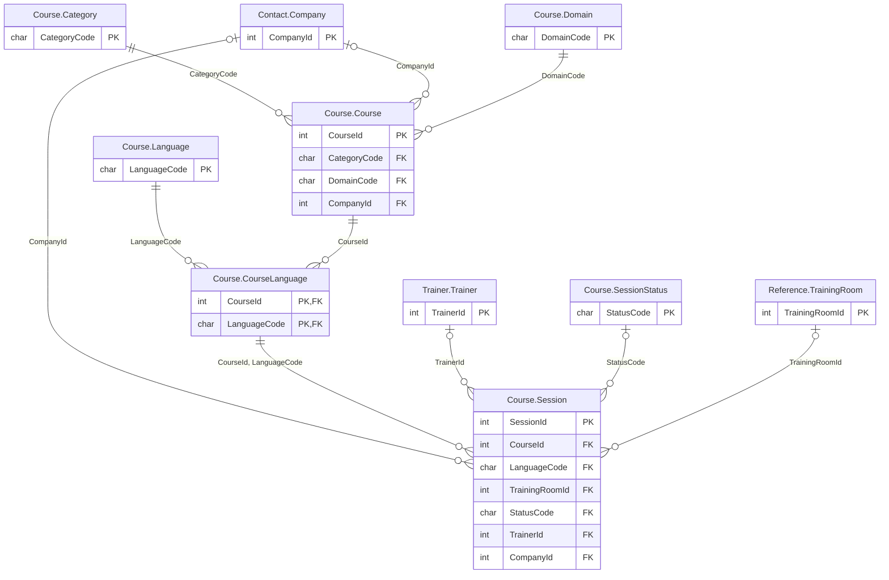

# Course schema

The `Course` schema has 7 tables and 21,891 rows. Back to the [schema overview](README.md).

## Entity-relationship diagram

Primary and foreign key columns only. Tables of other schemas appear when a table of this schema references them. A line is drawn from the referenced table to the referencing table: two bars mean exactly one parent, a circle and a bar mean at most one parent (nullable foreign key), and the crow's foot means any number of rows.

## Tables

### Course.Category

Reference table of course categories, 3 rows.

Rows: 3. Columns: 3.

| Column | Type | Nullable | Key | Default | Description |
|---|---|---|---|---|---|
| `CategoryCode` | `char(2)` | no | PK |  | Category code: SC (scheduled course in the catalog), SE (one or two day seminar) or CU (custom course built for one client). |
| `Label` | `varchar(50)` | no |  |  | Display name of the category. |
| `Description` | `varchar(300)` | yes |  |  | Short description of the category. |

### Course.Course

Course catalog, 514 courses: 379 scheduled, 15 seminars and 120 custom courses, of which 377 have been withdrawn.

Rows: 514. Columns: 11.

| Column | Type | Nullable | Key | Default | Description |
|---|---|---|---|---|---|
| `CourseId` | `int` | no | PK, identity |  | Course identifier, generated automatically. |
| `CategoryCode` | `char(2)` | no | FK to Course.Category |  | Category, in Course.Category: SC, SE or CU. |
| `DomainCode` | `char(2)` | no | FK to Course.Domain |  | Domain, in Course.Domain. |
| `CreationDate` | `smalldatetime` | no |  | `getdate()` | Date and time the course was added to the catalog. |
| `CancellationDate` | `date` | yes |  |  | Date the course was withdrawn from the catalog (always a December 31); NULL for the 137 courses still offered. |
| `PlanningComments` | `varchar(2000)` | yes |  |  | Planning comments; NULL on every row. |
| `ProductionComments` | `varchar(2000)` | yes |  |  | Production comments; NULL on every row. |
| `Duration` | `tinyint` | no |  | `5` | Length in days, from 1 to 5. |
| `MaxAttendees` | `tinyint` | no |  | `0` | Maximum number of learners per session, from 8 to 20. |
| `Code` | `varchar(20)` | yes |  |  | Catalog code of the course, such as PG15-OPT; H followed by a number for the 168 historical courses and SM followed by a number for custom courses. |
| `CompanyId` | `int` | yes | FK to Contact.Company |  | Client company of a custom course, in Contact.Company; NULL for the other categories. |

### Course.CourseLanguage

Texts of a course in each language: title, subtitle, summary, prerequisites, audience and objectives; one row per course and language.

Rows: 2,056. Columns: 8.

| Column | Type | Nullable | Key | Default | Description |
|---|---|---|---|---|---|
| `CourseId` | `int` | no | PK, FK to Course.Course |  | Course, in Course.Course; first part of the primary key. |
| `LanguageCode` | `char(2)` | no | PK, FK to Course.Language |  | Language of the texts, in Course.Language; second part of the primary key. |
| `Title` | `varchar(200)` | no |  |  | Course title. |
| `Subtitle` | `varchar(200)` | yes |  |  | Subtitle. |
| `Summary` | `varchar(500)` | yes |  |  | One-sentence summary of the course. |
| `Prerequisites` | `varchar(1000)` | yes |  |  | Knowledge expected from the learners. |
| `TargetAudience` | `varchar(500)` | yes |  |  | Profile of the learners the course is meant for. |
| `Objectives` | `varchar(1000)` | yes |  |  | Learning objectives, separated by semicolons. |

### Course.Domain

Reference table of course domains, 9 rows.

Rows: 9. Columns: 2.

| Column | Type | Nullable | Key | Default | Description |
|---|---|---|---|---|---|
| `DomainCode` | `char(2)` | no | PK |  | Domain code: DB, BI, DV, CL, SC, AI, MG, CO or PM. |
| `Label` | `varchar(50)` | no |  |  | Display name, such as Databases or Project management. |

### Course.Language

Languages in which courses are taught, 4 rows: FR, EN, DE and IT.

Rows: 4. Columns: 3.

| Column | Type | Nullable | Key | Default | Description |
|---|---|---|---|---|---|
| `LanguageCode` | `char(2)` | no | PK |  | Two-letter ISO 639-1 language code. |
| `LocalName` | `varchar(50)` | no |  |  | Name of the language in that language, such as Deutsch. |
| `FrenchName` | `varchar(50)` | no |  |  | Name of the language in French. |

### Course.Session

A course delivered on a given date in a given room, about 19,300 rows from 2011 to 2027, including future sessions.

Rows: 19,300. Columns: 14.

| Column | Type | Nullable | Key | Default | Description |
|---|---|---|---|---|---|
| `SessionId` | `int` | no | PK, identity |  | Session identifier, generated automatically. |
| `CourseId` | `int` | no | FK to Course.CourseLanguage |  | Course delivered, in Course.Course. |
| `LanguageCode` | `char(2)` | no | FK to Course.CourseLanguage |  | Language of the session, in Course.Language. |
| `TrainingRoomId` | `int` | yes | FK to Reference.TrainingRoom |  | Room where the session is held, in Reference.TrainingRoom. |
| `StartDate` | `date` | no |  |  | First day of the session. |
| `Price` | `decimal(8,2)` | yes |  |  | Price in euros: per day and per learner for an inter-company session, flat price of the whole session for an in-house session. |
| `Rating` | `tinyint` | yes |  |  | Satisfaction rating out of 20, computed from the 5-point answers of the evaluations; NULL when no evaluation exists (about 15 percent of the sessions). |
| `StatusCode` | `char(10)` | yes | FK to Course.SessionStatus |  | Status code, in Course.SessionStatus: PLANNED, OPEN, CONFIRMED, COMPLETED or CANCELED; stored as char(10), so the value is padded with spaces. |
| `CreationDate` | `date` | no |  | `getdate()` | Date the session was created. |
| `Duration` | `tinyint` | yes |  |  | Length in days, from 1 to 5, equal to the length of the course. |
| `IsInHouse` | `bit` | no |  | `0` | 1 for an in-house session held for a single client company (2,881 sessions), 0 for an inter-company session. |
| `Remarks` | `varchar(1500)` | yes |  |  | Short remark, such as an equipment request; NULL for about 90 percent of the sessions. |
| `TrainerId` | `int` | yes | FK to Trainer.Trainer |  | Trainer who delivers the session, in Trainer.Trainer. |
| `CompanyId` | `int` | yes | FK to Contact.Company |  | Client company of an in-house session, in Contact.Company; NULL for an inter-company session. |

### Course.SessionStatus

Reference table of session statuses, 5 rows.

Rows: 5. Columns: 2.

| Column | Type | Nullable | Key | Default | Description |
|---|---|---|---|---|---|
| `StatusCode` | `char(10)` | no | PK |  | Status code: PLANNED, OPEN, CONFIRMED, COMPLETED or CANCELED; stored as char(10), so the value is padded with spaces. |
| `Label` | `varchar(50)` | no |  |  | Display name, such as Open for enrollment. |

## Foreign keys

Indexed means that a rowstore index starts with the foreign key columns.

| Name | Table | Columns | References | Indexed |
|---|---|---|---|---|
| `fk_Course_Category` | Course.Course | `CategoryCode` | Course.Category | no |
| `fk_Course_Company` | Course.Course | `CompanyId` | Contact.Company | no |
| `fk_Course_Domain` | Course.Course | `DomainCode` | Course.Domain | no |
| `fk_CourseLanguage_has_Language` | Course.CourseLanguage | `LanguageCode` | Course.Language | no |
| `fk_CourseLanguage_isOn_Course` | Course.CourseLanguage | `CourseId` | Course.Course | yes |
| `fk_Session_Company` | Course.Session | `CompanyId` | Contact.Company | no |
| `fk_Session_has_CourseLanguage` | Course.Session | `CourseId`, `LanguageCode` | Course.CourseLanguage | yes |
| `fk_Session_has_Trainer` | Course.Session | `TrainerId` | Trainer.Trainer | no |
| `fk_Session_Status` | Course.Session | `StatusCode` | Course.SessionStatus | no |
| `fk_Session_TrainingRoom` | Course.Session | `TrainingRoomId` | Reference.TrainingRoom | no |
