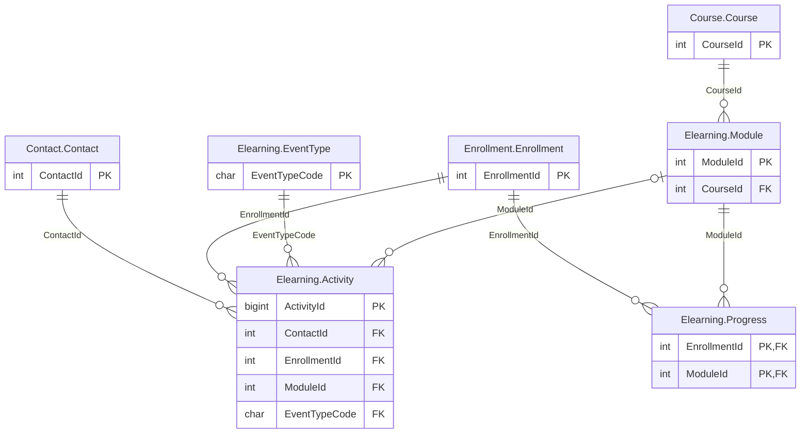

# Elearning schema

The `Elearning` schema has 4 tables and 8,058,371 rows. Back to the [schema overview](README.md).

## Entity-relationship diagram

Primary and foreign key columns only. Tables of other schemas appear when a table of this schema references them. A line is drawn from the referenced table to the referencing table: two bars mean exactly one parent, a circle and a bar mean at most one parent (nullable foreign key), and the crow's foot means any number of rows.

## Tables

### Elearning.Activity

Log of the learners' actions on the e-learning platform and in the virtual classroom, about 7.8 million rows from March 2018, stored as a heap with a non-clustered primary key.

Rows: 7,805,406. Columns: 10.

| Column | Type | Nullable | Key | Default | Description |
|---|---|---|---|---|---|
| `ActivityId` | `bigint` | no | PK |  | Event identifier, increasing with EventTime; non-clustered primary key. |
| `EventTime` | `datetime2(0)` | no |  |  | Date and time of the event, to the second. |
| `ContactId` | `int` | no | FK to Contact.Contact |  | Contact (learner) who produced the event. |
| `EnrollmentId` | `int` | no | FK to Enrollment.Enrollment |  | Enrollment the event belongs to. |
| `ModuleId` | `int` | yes | FK to Elearning.Module |  | E-learning module concerned, or NULL for login, logout and virtual classroom events. |
| `EventTypeCode` | `char(4)` | no | FK to Elearning.EventType |  | Event type code: CONN, DECO, OUVR, PAGE, VIDE, QUIZ, FINM or CVIR (login, logout, module opened, page read, video watched, quiz submitted, module completed, virtual classroom attendance). Codes are kept as in the French source and are not translated. |
| `Step` | `smallint` | yes |  |  | Rank of the page or video inside the module (1 to the module's step count), set only for page and video events. |
| `DurationSeconds` | `int` | yes |  |  | Duration of the page, video or virtual classroom attendance in seconds, NULL for the other event types. |
| `Score` | `tinyint` | yes |  |  | Quiz score from 0 to 100, set only for quiz events. |
| `Device` | `char(1)` | no |  |  | Device code: O (desktop or laptop computer), T (tablet) or M (mobile). Codes are kept as in the French source and are not translated. |

### Elearning.EventType

Reference table of the eight event types of the activity log.

Rows: 8. Columns: 2.

| Column | Type | Nullable | Key | Default | Description |
|---|---|---|---|---|---|
| `EventTypeCode` | `char(4)` | no | PK |  | Event type code: CONN, DECO, OUVR, PAGE, VIDE, QUIZ, FINM or CVIR; kept as in the French source. |
| `Label` | `varchar(50)` | no |  |  | Display name, such as Login, Logout, Module opened, Page read, Video watched, Quiz submitted, Module completed or Virtual classroom attendance. |

### Elearning.Module

E-learning modules attached to the courses: two preparation modules and two to four review modules per course, about 1,000 rows.

Rows: 992. Columns: 7.

| Column | Type | Nullable | Key | Default | Description |
|---|---|---|---|---|---|
| `ModuleId` | `int` | no | PK |  | Module identifier. |
| `CourseId` | `int` | no | FK to Course.Course |  | Course the module belongs to. |
| `Position` | `tinyint` | no |  |  | Rank of the module in its course: 1 and 2 for preparation modules, 3 to 6 for review modules. |
| `Title` | `varchar(200)` | no |  |  | Module title. |
| `Kind` | `char(4)` | no |  |  | Module kind: PREP (before the session) or REVW (after the session). |
| `DurationMinutes` | `smallint` | no |  |  | Estimated duration in minutes, from 24 to 160. |
| `StepCount` | `smallint` | no |  |  | Number of pages and videos in the module, from 6 to 40. |

### Elearning.Progress

Current state of an enrollment in a module as the platform displays it, computed from Elearning.Activity; the table also has a non-clustered columnstore index, so it serves both updates and analysis.

Rows: 251,965. Columns: 8.

| Column | Type | Nullable | Key | Default | Description |
|---|---|---|---|---|---|
| `EnrollmentId` | `int` | no | PK, FK to Enrollment.Enrollment |  | Enrollment; part of the clustered primary key. |
| `ModuleId` | `int` | no | PK, FK to Elearning.Module |  | Module; part of the clustered primary key. |
| `Status` | `char(1)` | no |  |  | Status code: D (done, the module was completed) or P (in progress). |
| `ProgressPercent` | `tinyint` | no |  |  | Percentage of distinct steps viewed, from 2 to 100, rounded down. |
| `BestScore` | `tinyint` | yes |  |  | Best quiz score from 40 to 100; NULL when no quiz was submitted. |
| `TimeSpentSeconds` | `int` | no |  |  | Total time spent in the module in seconds. |
| `FirstActivity` | `datetime2(0)` | no |  |  | Date and time of the first event in the module. |
| `LastActivity` | `datetime2(0)` | no |  |  | Date and time of the last event in the module. |

## Foreign keys

Indexed means that a rowstore index starts with the foreign key columns.

| Name | Table | Columns | References | Indexed |
|---|---|---|---|---|
| `fk_Activity_Contact` | Elearning.Activity | `ContactId` | Contact.Contact | no |
| `fk_Activity_Enrollment` | Elearning.Activity | `EnrollmentId` | Enrollment.Enrollment | no |
| `fk_Activity_EventType` | Elearning.Activity | `EventTypeCode` | Elearning.EventType | no |
| `fk_Activity_Module` | Elearning.Activity | `ModuleId` | Elearning.Module | no |
| `fk_Module_Course` | Elearning.Module | `CourseId` | Course.Course | yes |
| `fk_Progress_Enrollment` | Elearning.Progress | `EnrollmentId` | Enrollment.Enrollment | yes |
| `fk_Progress_Module` | Elearning.Progress | `ModuleId` | Elearning.Module | no |
