# Enrollment schema

The `Enrollment` schema has 15 tables and 2,079,247 rows. Back to the [schema overview](README.md).

## Entity-relationship diagram

Primary and foreign key columns only. Tables of other schemas appear when a table of this schema references them. A line is drawn from the referenced table to the referencing table: two bars mean exactly one parent, a circle and a bar mean at most one parent (nullable foreign key), and the crow's foot means any number of rows.

```mermaid
erDiagram
    Enrollment_Answer["Enrollment.Answer"] {
        int EvaluationId PK, FK
        smallint QuestionId PK, FK
    }
    Enrollment_CurrentEnrollment["Enrollment.CurrentEnrollment"]
    Enrollment_Enrollment["Enrollment.Enrollment"] {
        int EnrollmentId PK
        int SessionId FK
        int ContactId FK
    }
    Enrollment_Enrollment_Archive2011["Enrollment.Enrollment_Archive2011"]
    Enrollment_EnrollmentAddress["Enrollment.EnrollmentAddress"] {
        int EnrollmentId PK, FK
        int AddressId PK, FK
    }
    Enrollment_EnrollmentInvoice["Enrollment.EnrollmentInvoice"] {
        int EnrollmentId PK, FK
        varchar InvoiceCode PK, FK
    }
    Enrollment_Evaluation["Enrollment.Evaluation"] {
        int EvaluationId PK
        int EnrollmentId FK
        tinyint QuestionnaireId FK
    }
    Enrollment_Invoice["Enrollment.Invoice"] {
        varchar InvoiceCode PK
        varchar OriginalInvoiceCode FK
        int CompanyId FK
        int ContactId FK
        int SessionId FK
    }
    Enrollment_InvoiceHistory["Enrollment.InvoiceHistory"] {
        varchar InvoiceCode PK
    }
    Enrollment_InvoiceLine["Enrollment.InvoiceLine"] {
        varchar InvoiceCode PK, FK
        smallint LineNumber PK
        char LineTypeCode FK
        int EnrollmentId FK
    }
    Enrollment_InvoiceLineType["Enrollment.InvoiceLineType"] {
        char LineTypeCode PK
    }
    Enrollment_PartitionedEnrollment["Enrollment.PartitionedEnrollment"]
    Enrollment_Payment["Enrollment.Payment"] {
        int PaymentId PK
        varchar InvoiceCode FK
        char PaymentMethodCode FK
    }
    Enrollment_Question["Enrollment.Question"] {
        smallint QuestionId PK
        tinyint QuestionnaireId FK
    }
    Enrollment_Questionnaire["Enrollment.Questionnaire"] {
        tinyint QuestionnaireId PK
    }
    Contact_Address["Contact.Address"] {
        int AddressId PK
    }
    Contact_Company["Contact.Company"] {
        int CompanyId PK
    }
    Contact_Contact["Contact.Contact"] {
        int ContactId PK
    }
    Course_Session["Course.Session"] {
        int SessionId PK
    }
    Reference_PaymentMethod["Reference.PaymentMethod"] {
        char PaymentMethodCode PK
    }
    Enrollment_Evaluation ||--o{ Enrollment_Answer : "EvaluationId"
    Enrollment_Question ||--o{ Enrollment_Answer : "QuestionId"
    Contact_Contact |o--o{ Enrollment_Enrollment : "ContactId"
    Course_Session ||--o{ Enrollment_Enrollment : "SessionId"
    Contact_Address ||--o{ Enrollment_EnrollmentAddress : "AddressId"
    Enrollment_Enrollment ||--o{ Enrollment_EnrollmentAddress : "EnrollmentId"
    Enrollment_Enrollment ||--o{ Enrollment_EnrollmentInvoice : "EnrollmentId"
    Enrollment_Invoice ||--o{ Enrollment_EnrollmentInvoice : "InvoiceCode"
    Enrollment_Enrollment ||--o| Enrollment_Evaluation : "EnrollmentId"
    Enrollment_Questionnaire ||--o{ Enrollment_Evaluation : "QuestionnaireId"
    Contact_Company |o--o{ Enrollment_Invoice : "CompanyId"
    Contact_Contact |o--o{ Enrollment_Invoice : "ContactId"
    Enrollment_Invoice |o--o{ Enrollment_Invoice : "OriginalInvoiceCode"
    Course_Session |o--o{ Enrollment_Invoice : "SessionId"
    Enrollment_Enrollment |o--o{ Enrollment_InvoiceLine : "EnrollmentId"
    Enrollment_Invoice ||--o{ Enrollment_InvoiceLine : "InvoiceCode"
    Enrollment_InvoiceLineType ||--o{ Enrollment_InvoiceLine : "LineTypeCode"
    Enrollment_Invoice |o--o{ Enrollment_Payment : "InvoiceCode"
    Reference_PaymentMethod ||--o{ Enrollment_Payment : "PaymentMethodCode"
    Enrollment_Questionnaire ||--o{ Enrollment_Question : "QuestionnaireId"
```

## Tables

### Enrollment.Answer

Answers of an evaluation, one row per question answered (856,715 rows); each row has a rating, a free text, or both.

Rows: 856,715. Columns: 4.

| Column | Type | Nullable | Key | Default | Description |
|---|---|---|---|---|---|
| `EvaluationId` | `int` | no | PK, FK to Enrollment.Evaluation |  | Evaluation, in Enrollment.Evaluation; first part of the primary key. |
| `QuestionId` | `smallint` | no | PK, FK to Enrollment.Question |  | Question answered, in Enrollment.Question; second part of the primary key. |
| `Rating` | `tinyint` | yes |  |  | Rating on the scale of the question's answer type, from 0 to 10; NULL for a free text answer. |
| `Text` | `varchar(2000)` | yes |  |  | Free text answer, at most 2,000 characters, in French, German or Italian; NULL for a rating. |

### Enrollment.CurrentEnrollment

Demonstration copy of the 144,306 enrollments created from 2012-01-01, with only five columns; with the archive table it forms the whole of Enrollment.Enrollment.

Rows: 144,306. Columns: 5.

| Column | Type | Nullable | Key | Default | Description |
|---|---|---|---|---|---|
| `EnrollmentId` | `int` | no | identity |  | Enrollment identifier, generated automatically. |
| `SessionId` | `int` | no |  |  | Session, in Course.Session. |
| `ContactId` | `int` | yes |  |  | Learner, in Contact.Contact. |
| `CreationDate` | `smalldatetime` | no |  |  | Date and time the enrollment was created. |
| `OrderReference` | `varchar(100)` | yes |  |  | Customer purchase order reference; NULL for about half of the rows. |

### Enrollment.Enrollment

Enrollment of a contact in a session, about 151,000 rows from 2010 to 2026.

Rows: 151,236. Columns: 12.

| Column | Type | Nullable | Key | Default | Description |
|---|---|---|---|---|---|
| `EnrollmentId` | `int` | no | PK, identity |  | Enrollment identifier, generated automatically. |
| `SessionId` | `int` | no | FK to Course.Session |  | Session, in Course.Session. |
| `ContactId` | `int` | yes | FK to Contact.Contact |  | Learner, in Contact.Contact. |
| `CancellationDate` | `date` | yes |  |  | Date the enrollment was canceled; set for 12,085 enrollments and NULL for the others. |
| `Discount` | `tinyint` | no |  | `0` | Discount percentage of the learner's company, from 0 to 15. |
| `Attended` | `bit` | no |  | `0` | 1 when the learner attended the session. |
| `CreationDate` | `smalldatetime` | no |  | `getdate()` | Date and time the enrollment was created. |
| `OrderReference` | `varchar(100)` | yes |  |  | Customer purchase order reference; NULL for about half of the rows. |
| `AgreementSent` | `bit` | no |  | `0` | 1 when the training agreement was sent. |
| `JoiningInstructionsSent` | `bit` | no |  | `0` | 1 when the joining instructions were sent to the learner. |
| `WaitingList` | `bit` | no |  | `0` | 1 when the learner is on the waiting list because the session is full. |
| `AttendanceSheet` | `varchar(1000)` | yes |  |  | Attendance sheet text; NULL on every row. |

### Enrollment.Enrollment_Archive2011

Demonstration copy of the 6,930 enrollments created up to 2011-12-31, with only five columns.

Rows: 6,930. Columns: 5.

| Column | Type | Nullable | Key | Default | Description |
|---|---|---|---|---|---|
| `EnrollmentId` | `int` | no |  |  | Enrollment identifier. |
| `SessionId` | `int` | no |  |  | Session, in Course.Session. |
| `ContactId` | `int` | yes |  |  | Learner, in Contact.Contact. |
| `CreationDate` | `smalldatetime` | no |  |  | Date and time the enrollment was created. |
| `OrderReference` | `varchar(100)` | yes |  |  | Customer purchase order reference; NULL for about half of the rows. |

### Enrollment.EnrollmentAddress

Addresses to which the documents of an enrollment are sent, when they are not all sent to the company's main address; one row per address and enrollment.

Rows: 56,478. Columns: 7.

| Column | Type | Nullable | Key | Default | Description |
|---|---|---|---|---|---|
| `EnrollmentId` | `int` | no | PK, FK to Enrollment.Enrollment |  | Enrollment, in Enrollment.Enrollment. |
| `AddressId` | `int` | no | PK, FK to Contact.Address |  | Address the documents are sent to, in Contact.Address. |
| `Billing` | `bit` | no |  | `0` | 1 when the invoice is sent to this address. |
| `Agreement` | `bit` | no |  | `0` | 1 when the training agreement is sent to this address. |
| `AgreementLetter` | `bit` | no |  | `0` | 1 when the cover letter of the agreement is sent to this address. |
| `Certificate` | `bit` | no |  | `0` | 1 when the attendance certificate is sent to this address. |
| `Copy` | `bit` | no |  | `0` | 1 when a copy of the agreement is sent to this address. |

### Enrollment.EnrollmentInvoice

Link between enrollments and the invoice that bills them; one invoice covers several enrollments of the same session, 136,964 rows.

Rows: 136,964. Columns: 2.

| Column | Type | Nullable | Key | Default | Description |
|---|---|---|---|---|---|
| `EnrollmentId` | `int` | no | PK, FK to Enrollment.Enrollment |  | Enrollment billed, in Enrollment.Enrollment. |
| `InvoiceCode` | `varchar(50)` | no | PK, FK to Enrollment.Invoice |  | Invoice that bills it, in Enrollment.Invoice. |

### Enrollment.Evaluation

Satisfaction questionnaire filled in by a learner for an enrollment, at most one per enrollment (86,404 rows).

Rows: 86,404. Columns: 5.

| Column | Type | Nullable | Key | Default | Description |
|---|---|---|---|---|---|
| `EvaluationId` | `int` | no | PK |  | Evaluation identifier; primary key. |
| `EnrollmentId` | `int` | no | FK to Enrollment.Enrollment |  | Enrollment evaluated; unique. |
| `QuestionnaireId` | `tinyint` | no | FK to Enrollment.Questionnaire |  | Questionnaire version that was answered, in Enrollment.Questionnaire. |
| `EvaluationDate` | `datetime2(0)` | no |  |  | Date and time the questionnaire was filled in. |
| `Channel` | `varchar(6)` | no |  |  | Channel code: PAPER (printed form) or WEB. |

### Enrollment.Invoice

Invoices and credit notes issued from September 2010, about 107,000 invoices and 3,300 credit notes.

Rows: 110,737. Columns: 18.

| Column | Type | Nullable | Key | Default | Description |
|---|---|---|---|---|---|
| `InvoiceCode` | `varchar(50)` | no | PK |  | Document number, FAyyyy-nnnnnn for an invoice and AVyyyy-nnnnnn for a credit note. |
| `DiscountCode` | `char(2)` | yes |  |  | Discount code; NULL on every row. |
| `Discount` | `decimal(10,7)` | yes |  |  | Discount percentage of the company, from 0 to 15. |
| `CreationDate` | `smalldatetime` | no |  |  | Date and time the document was created. |
| `InvoiceDate` | `date` | yes |  |  | Date of the document. |
| `ReminderLevel` | `tinyint` | no |  | `0` | Number of payment reminders sent, from 0 to 3. |
| `ReminderDate` | `date` | yes |  |  | Date of the last reminder; NULL when no reminder was sent. |
| `OrderReference` | `varchar(100)` | yes |  |  | Customer purchase order reference, in the customer's own format; NULL for part of the documents. |
| `NetAmount` | `decimal(9,2)` | no |  |  | Amount excluding VAT in euros, the sum of the document's lines; negative on a credit note. |
| `GrossAmount` | `decimal(9,2)` | no |  |  | Amount including VAT in euros, NetAmount rounded after applying VatRate; negative on a credit note. |
| `VatRate` | `decimal(5,2)` | no |  |  | VAT rate in percent: 0, 19.6 or 20. |
| `DocumentType` | `char(1)` | no |  | `'I'` | Document type code: I (invoice) or C (credit note). |
| `OriginalInvoiceCode` | `varchar(50)` | yes | FK to Enrollment.Invoice |  | For a credit note, the invoice it cancels or reduces; NULL on an invoice. |
| `CompanyId` | `int` | yes | FK to Contact.Company |  | Invoiced company, in Contact.Company; NULL when the customer is an individual. |
| `ContactId` | `int` | yes | FK to Contact.Contact |  | Invoiced individual, in Contact.Contact; NULL when the customer is a company. |
| `DueDate` | `date` | yes |  |  | Payment due date, 30 days after the invoice date (45 for administrations); NULL on a credit note. |
| `Reason` | `varchar(200)` | yes |  |  | Reason of a credit note, such as Goodwill gesture or Discount error; NULL on an invoice. |
| `SessionId` | `int` | yes | FK to Course.Session |  | Session invoiced; the only direct link from an in-house invoice to its session. |

### Enrollment.InvoiceHistory

Invoices and credit notes from January 2004 to August 2010 taken over from the former invoicing software (20,591 rows), with the same columns as Enrollment.Invoice and no foreign keys; combined with it by the partitioned view dbo.InvoiceAll.

Rows: 20,591. Columns: 18.

| Column | Type | Nullable | Key | Default | Description |
|---|---|---|---|---|---|
| `InvoiceCode` | `varchar(50)` | no | PK |  | Document number, FAyyyy-nnnnnn for an invoice and AVyyyy-nnnnnn for a credit note. |
| `DiscountCode` | `char(2)` | yes |  |  | Discount code; NULL on every row. |
| `Discount` | `decimal(10,7)` | yes |  |  | Discount percentage of the company, from 0 to 15. |
| `CreationDate` | `smalldatetime` | no |  |  | Date and time the document was created. |
| `InvoiceDate` | `date` | no |  |  | Date of the document, between January 2004 and August 2010. |
| `ReminderLevel` | `tinyint` | no |  |  | Number of payment reminders sent, from 0 to 3. |
| `ReminderDate` | `date` | yes |  |  | Date of the last reminder; NULL when no reminder was sent. |
| `OrderReference` | `varchar(100)` | yes |  |  | Customer purchase order reference, in the customer's own format; NULL for part of the documents. |
| `NetAmount` | `decimal(9,2)` | no |  |  | Amount excluding VAT in euros, the sum of the document's lines; negative on a credit note. |
| `GrossAmount` | `decimal(9,2)` | no |  |  | Amount including VAT in euros, NetAmount rounded after applying VatRate; negative on a credit note. |
| `VatRate` | `decimal(5,2)` | no |  |  | VAT rate in percent: 0, 19.6 or 20. |
| `DocumentType` | `char(1)` | no |  |  | Document type code: I (invoice) or C (credit note). |
| `OriginalInvoiceCode` | `varchar(50)` | yes |  |  | For a credit note, the invoice it cancels or reduces; NULL on an invoice. |
| `CompanyId` | `int` | yes |  |  | Invoiced company, in Contact.Company; NULL when the customer is an individual. |
| `ContactId` | `int` | yes |  |  | Invoiced individual, in Contact.Contact; NULL when the customer is a company. |
| `DueDate` | `date` | yes |  |  | Payment due date, 30 days after the invoice date (45 for administrations); NULL on a credit note. |
| `Reason` | `varchar(200)` | yes |  |  | Reason of a credit note, such as Goodwill gesture or Discount error; NULL on an invoice. |
| `SessionId` | `int` | yes |  |  | Session invoiced; always NULL because the former invoicing software did not know sessions. |

### Enrollment.InvoiceLine

Lines of the invoices and credit notes issued since September 2010, about 250,000 rows; the net amount of a document is the sum of its lines.

Rows: 250,198. Columns: 8.

| Column | Type | Nullable | Key | Default | Description |
|---|---|---|---|---|---|
| `InvoiceCode` | `varchar(50)` | no | PK, FK to Enrollment.Invoice |  | Invoice or credit note, in Enrollment.Invoice; first part of the primary key. |
| `LineNumber` | `smallint` | no | PK |  | Line number inside the document, starting at 1; second part of the primary key. |
| `LineTypeCode` | `char(4)` | no | FK to Enrollment.InvoiceLineType |  | Line type code, in Enrollment.InvoiceLineType: COUR (course), MEAL, MATL (printed course material) or FEE (file fee). |
| `EnrollmentId` | `int` | yes | FK to Enrollment.Enrollment |  | Enrollment billed by the line; NULL for fee lines, for the flat-rate line of an in-house session and for the line of a partial credit note. |
| `Label` | `varchar(200)` | no |  |  | Line text, for a course line of the form: course title, dates and learner name. |
| `Quantity` | `decimal(9,2)` | no |  |  | Quantity: days, meals or units, from 1 to 60. |
| `UnitPrice` | `decimal(9,2)` | no |  |  | Unit price in euros excluding VAT, after discount for courses; negative on a credit note. |
| `NetAmount` | `decimal(9,2)` | no |  |  | Quantity times unit price, rounded to cents. |

### Enrollment.InvoiceLineType

Reference table of invoice line types.

Rows: 4. Columns: 2.

| Column | Type | Nullable | Key | Default | Description |
|---|---|---|---|---|---|
| `LineTypeCode` | `char(4)` | no | PK |  | Line type code: COUR (course), MEAL, MATL (printed course material) or FEE (file fee). |
| `Label` | `varchar(50)` | no |  |  | Display name of the line type. |

### Enrollment.PartitionedEnrollment

Demonstration copy of all 151,236 enrollments, with five columns, partitioned on CreationDate.

Rows: 151,236. Columns: 5.

| Column | Type | Nullable | Key | Default | Description |
|---|---|---|---|---|---|
| `EnrollmentId` | `int` | no |  |  | Enrollment identifier. |
| `SessionId` | `int` | no |  |  | Session, in Course.Session. |
| `ContactId` | `int` | yes |  |  | Learner, in Contact.Contact. |
| `CreationDate` | `smalldatetime` | no |  |  | Date and time the enrollment was created. |
| `OrderReference` | `varchar(100)` | yes |  |  | Customer purchase order reference; NULL for about half of the rows. |

### Enrollment.Payment

Payments received for invoices, about 107,000 rows from October 2010; a credit note is not paid, it reduces the balance of its invoice.

Rows: 107,409. Columns: 7.

| Column | Type | Nullable | Key | Default | Description |
|---|---|---|---|---|---|
| `PaymentId` | `int` | no | PK, identity |  | Payment identifier, generated automatically. |
| `InvoiceCode` | `varchar(50)` | yes | FK to Enrollment.Invoice |  | Invoice paid, in Enrollment.Invoice. |
| `PaymentDate` | `date` | no |  |  | Date the payment was received. |
| `CheckNumber` | `varchar(50)` | yes |  |  | Check number; set only for payments by check. |
| `SlipNumber` | `varchar(10)` | yes |  |  | Bank deposit slip number; set only for payments by check. |
| `Amount` | `decimal(8,2)` | no |  |  | Amount paid in euros, from 191.25 to 33,624; a partial payment is less than the invoice total. |
| `PaymentMethodCode` | `char(8)` | no | FK to Reference.PaymentMethod |  | Payment method code, in Reference.PaymentMethod: WIRE, CARD, CHECK or DEBIT; stored as char(8), so the value is padded with spaces. |

### Enrollment.Question

Questions of the three versions of the satisfaction questionnaire, 36 rows.

Rows: 36. Columns: 6.

| Column | Type | Nullable | Key | Default | Description |
|---|---|---|---|---|---|
| `QuestionId` | `smallint` | no | PK |  | Question identifier. |
| `QuestionnaireId` | `tinyint` | no | FK to Enrollment.Questionnaire |  | Questionnaire version the question belongs to. |
| `Position` | `tinyint` | no |  |  | Rank of the question inside its questionnaire. |
| `Theme` | `varchar(20)` | no |  |  | Theme: objectives, content, delivery, materials, logistics or overall. |
| `Label` | `varchar(300)` | no |  |  | Text of the question as shown to the learner. |
| `AnswerType` | `varchar(6)` | no |  |  | Answer type code: RATE5 (rating from 1 to 5), RATE10 (rating from 0 to 10), YESNO (0 or 1) or TEXT (free text). |

### Enrollment.Questionnaire

Versions of the satisfaction questionnaire: Paper (2011 to 2017), Online v1 (2018 to 2022) and Online v2 (since 2023), 3 rows.

Rows: 3. Columns: 4.

| Column | Type | Nullable | Key | Default | Description |
|---|---|---|---|---|---|
| `QuestionnaireId` | `tinyint` | no | PK |  | Questionnaire identifier. |
| `Name` | `varchar(50)` | no |  |  | Version name: Paper, Online v1 or Online v2. |
| `StartDate` | `date` | no |  |  | First day the version is in use. |
| `EndDate` | `date` | yes |  |  | Last day the version is in use; NULL for the current one. |

## Foreign keys

Indexed means that a rowstore index starts with the foreign key columns.

| Name | Table | Columns | References | Indexed |
|---|---|---|---|---|
| `fk_Answer_Evaluation` | Enrollment.Answer | `EvaluationId` | Enrollment.Evaluation | yes |
| `fk_Answer_Question` | Enrollment.Answer | `QuestionId` | Enrollment.Question | no |
| `fk_Enrollment_Contact` | Enrollment.Enrollment | `ContactId` | Contact.Contact | no |
| `fk_Enrollment_Session` | Enrollment.Enrollment | `SessionId` | Course.Session | yes |
| `fk_EnrollmentAddress_Address` | Enrollment.EnrollmentAddress | `AddressId` | Contact.Address | no |
| `fk_EnrollmentAddress_Enrollment` | Enrollment.EnrollmentAddress | `EnrollmentId` | Enrollment.Enrollment | yes |
| `fk_EnrollmentInvoice_Enrollment` | Enrollment.EnrollmentInvoice | `EnrollmentId` | Enrollment.Enrollment | yes |
| `fk_EnrollmentInvoice_Invoice` | Enrollment.EnrollmentInvoice | `InvoiceCode` | Enrollment.Invoice | no |
| `fk_Evaluation_Enrollment` | Enrollment.Evaluation | `EnrollmentId` | Enrollment.Enrollment | yes |
| `fk_Evaluation_Questionnaire` | Enrollment.Evaluation | `QuestionnaireId` | Enrollment.Questionnaire | no |
| `fk_Invoice_Company` | Enrollment.Invoice | `CompanyId` | Contact.Company | no |
| `fk_Invoice_Contact` | Enrollment.Invoice | `ContactId` | Contact.Contact | no |
| `fk_Invoice_Origin` | Enrollment.Invoice | `OriginalInvoiceCode` | Enrollment.Invoice | no |
| `fk_Invoice_Session` | Enrollment.Invoice | `SessionId` | Course.Session | no |
| `fk_InvoiceLine_Enrollment` | Enrollment.InvoiceLine | `EnrollmentId` | Enrollment.Enrollment | no |
| `fk_InvoiceLine_Invoice` | Enrollment.InvoiceLine | `InvoiceCode` | Enrollment.Invoice | yes |
| `fk_InvoiceLine_LineTypeCode` | Enrollment.InvoiceLine | `LineTypeCode` | Enrollment.InvoiceLineType | no |
| `fk_Payment_Invoice` | Enrollment.Payment | `InvoiceCode` | Enrollment.Invoice | no |
| `fk_Payment_PaymentMethod` | Enrollment.Payment | `PaymentMethodCode` | Reference.PaymentMethod | no |
| `fk_Question_Questionnaire` | Enrollment.Question | `QuestionnaireId` | Enrollment.Questionnaire | yes |
