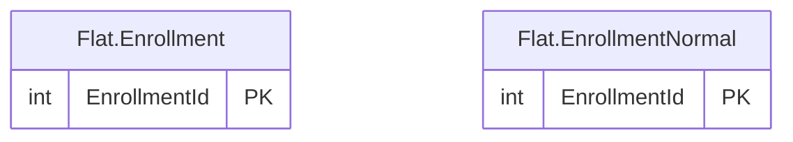

# Flat schema

The `Flat` schema has 2 tables and 302,472 rows. Back to the [schema overview](README.md).

## Entity-relationship diagram

Primary and foreign key columns only. Tables of other schemas appear when a table of this schema references them. A line is drawn from the referenced table to the referencing table: two bars mean exactly one parent, a circle and a bar mean at most one parent (nullable foreign key), and the crow's foot means any number of rows.

## Tables

### Flat.Enrollment

One row per enrollment, with the name, city and meal flat fee of the training location repeated on every row; a deliberately denormalized table, since those three columns depend on the location and not on the enrollment.

Rows: 151,236. Columns: 7.

| Column | Type | Nullable | Key | Default | Description |
|---|---|---|---|---|---|
| `EnrollmentId` | `int` | no | PK |  | Enrollment identifier; primary key. |
| `ContactId` | `int` | no |  |  | Contact who enrolled. |
| `EnrollmentDate` | `date` | no |  |  | Date the enrollment was created. |
| `TrainingLocationId` | `int` | no |  |  | Training location where the learner attends the course. |
| `LocationName` | `varchar(50)` | no |  |  | Name of the training location, repeated from the location table. |
| `City` | `varchar(50)` | yes |  |  | City of the training location, repeated from the location table; NULL for the virtual classroom. |
| `MealFlatFee` | `decimal(5,2)` | no |  |  | Meal flat fee of the location in euros per learner per day, repeated from the location table. |

### Flat.EnrollmentNormal

The same rows as Flat.Enrollment without the three columns repeated from the location, which is the normalized form of that table.

Rows: 151,236. Columns: 4.

| Column | Type | Nullable | Key | Default | Description |
|---|---|---|---|---|---|
| `EnrollmentId` | `int` | no | PK |  | Enrollment identifier; primary key. |
| `ContactId` | `int` | no |  |  | Contact who enrolled. |
| `EnrollmentDate` | `date` | no |  |  | Date the enrollment was created. |
| `TrainingLocationId` | `int` | no |  |  | Training location where the learner attends the course. |

## Foreign keys

No table of this schema has a foreign key.
