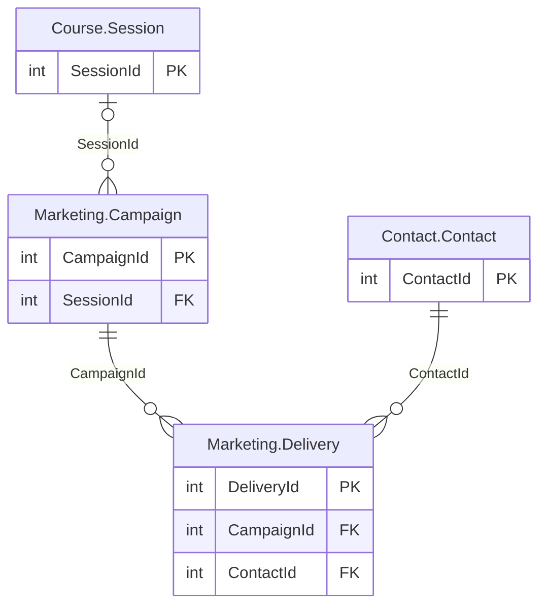

# Marketing schema

The `Marketing` schema has 2 tables and 4,034,730 rows. Back to the [schema overview](README.md).

## Entity-relationship diagram

Primary and foreign key columns only. Tables of other schemas appear when a table of this schema references them. A line is drawn from the referenced table to the referencing table: two bars mean exactly one parent, a circle and a bar mean at most one parent (nullable foreign key), and the crow's foot means any number of rows.

## Tables

### Marketing.Campaign

E-mail campaigns: one evaluation campaign per completed session plus 36 monthly newsletters, about 16,400 rows from 2011.

Rows: 16,426. Columns: 5.

| Column | Type | Nullable | Key | Default | Description |
|---|---|---|---|---|---|
| `CampaignId` | `int` | no | PK |  | Campaign identifier. |
| `CampaignType` | `varchar(10)` | no |  |  | Campaign type: Evaluation (satisfaction questionnaire after a session) or Letter (monthly newsletter). |
| `Name` | `varchar(100)` | no |  |  | Campaign name, in French, such as the course code and date for an evaluation or the month for a newsletter. |
| `SendDate` | `date` | no |  |  | Date the campaign was sent. |
| `SessionId` | `int` | yes | FK to Course.Session |  | Session concerned, for an evaluation campaign; NULL for a newsletter. |

### Marketing.Delivery

One e-mail sent to a contact in a campaign, about 4 million rows with a very uneven distribution per campaign (an evaluation campaign reaches the learners of one session).

Rows: 4,018,304. Columns: 6.

| Column | Type | Nullable | Key | Default | Description |
|---|---|---|---|---|---|
| `DeliveryId` | `int` | no | PK, identity |  | Delivery identifier, generated automatically. |
| `CampaignId` | `int` | no | FK to Marketing.Campaign |  | Campaign, in Marketing.Campaign. |
| `ContactId` | `int` | no | FK to Contact.Contact |  | Contact who received the e-mail. |
| `SendDate` | `datetime2(0)` | no |  |  | Date and time the e-mail was sent. |
| `Opened` | `bit` | no |  |  | 1 when the contact opened the e-mail. |
| `Clicked` | `bit` | no |  |  | 1 when the contact clicked a link; a click always implies that the e-mail was opened. |

## Foreign keys

Indexed means that a rowstore index starts with the foreign key columns.

| Name | Table | Columns | References | Indexed |
|---|---|---|---|---|
| `fk_Campaign_Session` | Marketing.Campaign | `SessionId` | Course.Session | no |
| `fk_Delivery_Campaign` | Marketing.Delivery | `CampaignId` | Marketing.Campaign | yes |
| `fk_Delivery_Contact` | Marketing.Delivery | `ContactId` | Contact.Contact | yes |
