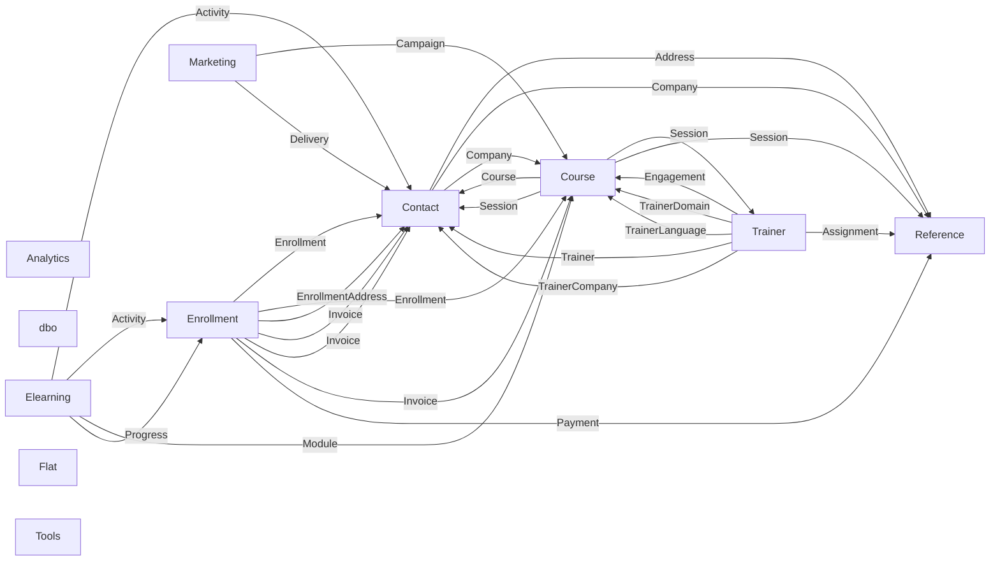

# Schemas

The database has 64 tables in 11 schemas, with 26,759,034 rows in all. Each schema has a page with an entity-relationship diagram and the dictionary of its columns. The descriptions come from the `MS_Description` extended properties of the database.

## Relationships between schemas

One arrow per foreign key that crosses two schemas (26 of the 68 foreign keys). The arrow goes from the schema of the referencing table, named on the arrow, to the schema of the referenced table.

## Tables by schema

| Schema | Table | Rows | Columns | Description |
|---|---|---|---|---|
| [Analytics](Analytics.md) | [ActivityFact](Analytics.md#analyticsactivityfact) | 7,805,406 | 12 | Copy of Elearning.Activity stored in an ordered clustered columnstore index on EventTime, with the session, course and location copied onto each row for aggregates and window functions; it has no ActivityId. |
| [Analytics](Analytics.md) | [LoadTest](Analytics.md#analyticsloadtest) | 0 | 12 | Empty copy of ActivityFact with the same columnstore structure, used to try the bulk load threshold of 102,400 rows per batch. |
| [Contact](Contact.md) | [Address](Contact.md#contactaddress) | 128,183 | 5 | Postal addresses of contacts, companies and trainer companies; several rows of other tables can point to the same address. |
| [Contact](Contact.md) | [AddressType](Contact.md#contactaddresstype) | 3 | 2 | Reference table of address types. |
| [Contact](Contact.md) | [Company](Contact.md#contactcompany) | 2,000 | 14 | Client companies, about 2,000 fictitious companies in ten countries. |
| [Contact](Contact.md) | [CompanyAddress](Contact.md#contactcompanyaddress) | 2,408 | 3 | Addresses of a company by type: every company has a main address and about one in five has a distinct billing address. |
| [Contact](Contact.md) | [Contact](Contact.md#contactcontact) | 120,140 | 12 | People known to the company: learners, company employees and trainers, about 120,000 rows with names, e-mail addresses and phone numbers invented by a generator. |
| [Contact](Contact.md) | [Employee](Contact.md#contactemployee) | 105,580 | 5 | Organization chart of the client companies, one row per contact of a company who is not a trainer; the reporting line is a self-reference used for recursive queries. |
| [Contact](Contact.md) | [ProspectUS](Contact.md#contactprospectus) | 1,000,000 | 8 | One million fictitious US prospects, stored as a heap with varchar columns; the reference table for the prospect demonstrations. |
| [Contact](Contact.md) | [ProspectUS_MAX](Contact.md#contactprospectus_max) | 1,000,000 | 7 | The same one million prospects with every text column declared varchar(max), to show what the declared length costs. |
| [Contact](Contact.md) | [ProspectUS_N](Contact.md#contactprospectus_n) | 1,000,000 | 7 | The same one million prospects with nvarchar columns, to compare the size of Unicode and non-Unicode storage. |
| [Contact](Contact.md) | [ProspectUS_SQL_Latin1](Contact.md#contactprospectus_sql_latin1) | 1,000,000 | 7 | The same one million prospects with the columns in the collation SQL_Latin1_General_CP1_CI_AS instead of the database collation, to compare collation behavior. |
| [Course](Course.md) | [Category](Course.md#coursecategory) | 3 | 3 | Reference table of course categories, 3 rows. |
| [Course](Course.md) | [Course](Course.md#coursecourse) | 514 | 11 | Course catalog, 514 courses: 379 scheduled, 15 seminars and 120 custom courses, of which 377 have been withdrawn. |
| [Course](Course.md) | [CourseLanguage](Course.md#coursecourselanguage) | 2,056 | 8 | Texts of a course in each language: title, subtitle, summary, prerequisites, audience and objectives; one row per course and language. |
| [Course](Course.md) | [Domain](Course.md#coursedomain) | 9 | 2 | Reference table of course domains, 9 rows. |
| [Course](Course.md) | [Language](Course.md#courselanguage) | 4 | 3 | Languages in which courses are taught, 4 rows: FR, EN, DE and IT. |
| [Course](Course.md) | [Session](Course.md#coursesession) | 19,300 | 14 | A course delivered on a given date in a given room, about 19,300 rows from 2011 to 2027, including future sessions. |
| [Course](Course.md) | [SessionStatus](Course.md#coursesessionstatus) | 5 | 2 | Reference table of session statuses, 5 rows. |
| [dbo](dbo.md) | [IgnoredRead](dbo.md#dboignoredread) | 5 | 1 | Demonstration table of five rows (1 to 5), used to show the READPAST locking hint. |
| [dbo](dbo.md) | [LoopTest](dbo.md#dbolooptest) | 45 | 3 | Demonstration table of 45 rows in three groups (10, 20 and 15 rows), used to number rows with an UPDATE in a loop. |
| [Elearning](Elearning.md) | [Activity](Elearning.md#elearningactivity) | 7,805,406 | 10 | Log of the learners' actions on the e-learning platform and in the virtual classroom, about 7.8 million rows from March 2018, stored as a heap with a non-clustered primary key. |
| [Elearning](Elearning.md) | [EventType](Elearning.md#elearningeventtype) | 8 | 2 | Reference table of the eight event types of the activity log. |
| [Elearning](Elearning.md) | [Module](Elearning.md#elearningmodule) | 992 | 7 | E-learning modules attached to the courses: two preparation modules and two to four review modules per course, about 1,000 rows. |
| [Elearning](Elearning.md) | [Progress](Elearning.md#elearningprogress) | 251,965 | 8 | Current state of an enrollment in a module as the platform displays it, computed from Elearning.Activity; the table also has a non-clustered columnstore index, so it serves both updates and analysis. |
| [Enrollment](Enrollment.md) | [Answer](Enrollment.md#enrollmentanswer) | 856,715 | 4 | Answers of an evaluation, one row per question answered (856,715 rows); each row has a rating, a free text, or both. |
| [Enrollment](Enrollment.md) | [CurrentEnrollment](Enrollment.md#enrollmentcurrentenrollment) | 144,306 | 5 | Demonstration copy of the 144,306 enrollments created from 2012-01-01, with only five columns; with the archive table it forms the whole of Enrollment.Enrollment. |
| [Enrollment](Enrollment.md) | [Enrollment](Enrollment.md#enrollmentenrollment) | 151,236 | 12 | Enrollment of a contact in a session, about 151,000 rows from 2010 to 2026. |
| [Enrollment](Enrollment.md) | [Enrollment_Archive2011](Enrollment.md#enrollmentenrollment_archive2011) | 6,930 | 5 | Demonstration copy of the 6,930 enrollments created up to 2011-12-31, with only five columns. |
| [Enrollment](Enrollment.md) | [EnrollmentAddress](Enrollment.md#enrollmentenrollmentaddress) | 56,478 | 7 | Addresses to which the documents of an enrollment are sent, when they are not all sent to the company's main address; one row per address and enrollment. |
| [Enrollment](Enrollment.md) | [EnrollmentInvoice](Enrollment.md#enrollmentenrollmentinvoice) | 136,964 | 2 | Link between enrollments and the invoice that bills them; one invoice covers several enrollments of the same session, 136,964 rows. |
| [Enrollment](Enrollment.md) | [Evaluation](Enrollment.md#enrollmentevaluation) | 86,404 | 5 | Satisfaction questionnaire filled in by a learner for an enrollment, at most one per enrollment (86,404 rows). |
| [Enrollment](Enrollment.md) | [Invoice](Enrollment.md#enrollmentinvoice) | 110,737 | 18 | Invoices and credit notes issued from September 2010, about 107,000 invoices and 3,300 credit notes. |
| [Enrollment](Enrollment.md) | [InvoiceHistory](Enrollment.md#enrollmentinvoicehistory) | 20,591 | 18 | Invoices and credit notes from January 2004 to August 2010 taken over from the former invoicing software (20,591 rows), with the same columns as Enrollment.Invoice and no foreign keys; combined with it by the partitioned view dbo.InvoiceAll. |
| [Enrollment](Enrollment.md) | [InvoiceLine](Enrollment.md#enrollmentinvoiceline) | 250,198 | 8 | Lines of the invoices and credit notes issued since September 2010, about 250,000 rows; the net amount of a document is the sum of its lines. |
| [Enrollment](Enrollment.md) | [InvoiceLineType](Enrollment.md#enrollmentinvoicelinetype) | 4 | 2 | Reference table of invoice line types. |
| [Enrollment](Enrollment.md) | [PartitionedEnrollment](Enrollment.md#enrollmentpartitionedenrollment) | 151,236 | 5 | Demonstration copy of all 151,236 enrollments, with five columns, partitioned on CreationDate. |
| [Enrollment](Enrollment.md) | [Payment](Enrollment.md#enrollmentpayment) | 107,409 | 7 | Payments received for invoices, about 107,000 rows from October 2010; a credit note is not paid, it reduces the balance of its invoice. |
| [Enrollment](Enrollment.md) | [Question](Enrollment.md#enrollmentquestion) | 36 | 6 | Questions of the three versions of the satisfaction questionnaire, 36 rows. |
| [Enrollment](Enrollment.md) | [Questionnaire](Enrollment.md#enrollmentquestionnaire) | 3 | 4 | Versions of the satisfaction questionnaire: Paper (2011 to 2017), Online v1 (2018 to 2022) and Online v2 (since 2023), 3 rows. |
| [Flat](Flat.md) | [Enrollment](Flat.md#flatenrollment) | 151,236 | 7 | One row per enrollment, with the name, city and meal flat fee of the training location repeated on every row; a deliberately denormalized table, since those three columns depend on the location and not on the enrollment. |
| [Flat](Flat.md) | [EnrollmentNormal](Flat.md#flatenrollmentnormal) | 151,236 | 4 | The same rows as Flat.Enrollment without the three columns repeated from the location, which is the normalized form of that table. |
| [Marketing](Marketing.md) | [Campaign](Marketing.md#marketingcampaign) | 16,426 | 5 | E-mail campaigns: one evaluation campaign per completed session plus 36 monthly newsletters, about 16,400 rows from 2011. |
| [Marketing](Marketing.md) | [Delivery](Marketing.md#marketingdelivery) | 4,018,304 | 6 | One e-mail sent to a contact in a campaign, about 4 million rows with a very uneven distribution per campaign (an evaluation campaign reaches the learners of one session). |
| [Reference](Reference.md) | [City](Reference.md#referencecity) | 35,480 | 11 | Cities and postal codes, 35,249 French communes plus 231 principal cities of nine other countries; several columns have deliberately imperfect types. |
| [Reference](Reference.md) | [Country](Reference.md#referencecountry) | 239 | 5 | Countries of the world, 239 rows, with their French and English names. |
| [Reference](Reference.md) | [Currency](Reference.md#referencecurrency) | 5 | 2 | Currencies, 5 rows: EUR, USD, CHF, GBP and FRF; a demonstration table for the trigger chapter. |
| [Reference](Reference.md) | [CurrencyArchive](Reference.md#referencecurrencyarchive) | 0 | 3 | Archive of deleted currencies, filled by a trigger in the demonstrations; empty in the delivered database. |
| [Reference](Reference.md) | [CurrencyHistory](Reference.md#referencecurrencyhistory) | 3 | 4 | Exchange rates by period, 3 rows (USD for 2024 and 2025, CHF for 2024); a demonstration table for checking that periods do not overlap. |
| [Reference](Reference.md) | [Holiday](Reference.md#referenceholiday) | 949 | 3 | National public holidays from 2010 to 2028 for France, Belgium, Switzerland, Germany and Italy, about 950 rows; sessions are not scheduled on them. |
| [Reference](Reference.md) | [PaymentMethod](Reference.md#referencepaymentmethod) | 5 | 2 | Reference table of payment methods, 5 rows. |
| [Reference](Reference.md) | [Region](Reference.md#referenceregion) | 96 | 16 | The 96 departments of metropolitan France with their region, prefecture and boundaries; despite its name, it holds one row per department. |
| [Reference](Reference.md) | [TrainingLocation](Reference.md#referencetraininglocation) | 43 | 17 | Places where sessions are held, 43 rows: 26 Pacha centers, partner venues, and the virtual classroom, in France, Switzerland, Belgium, Germany and Italy. |
| [Reference](Reference.md) | [TrainingRoom](Reference.md#referencetrainingroom) | 187 | 8 | Rooms of the training locations, 187 rows with 10 to 20 seats. |
| [Reference](Reference.md) | [VatRate](Reference.md#referencevatrate) | 3 | 4 | French VAT rates by period, 3 rows. |
| [Tools](Tools.md) | [CalendarDay](Tools.md#toolscalendarday) | 30,000 | 2 | Calendar table with one row per day from 1990-01-02 to 2072-02-20 (30,000 rows). |
| [Tools](Tools.md) | [Number](Tools.md#toolsnumber) | 20,083 | 1 | Numbers table of the integers from 1 to 20,083, used to generate rows. |
| [Trainer](Trainer.md) | [Assignment](Trainer.md#trainerassignment) | 605 | 4 | Dated assignment of a trainer to a home training center, derived from the sessions the trainer delivered in each calendar year; 605 rows. |
| [Trainer](Trainer.md) | [Engagement](Trainer.md#trainerengagement) | 9,590 | 9 | What an independent trainer's company invoices to the company for one session delivered, one row per completed session (9,590 rows). |
| [Trainer](Trainer.md) | [Trainer](Trainer.md#trainertrainer) | 80 | 12 | Trainers who deliver sessions, 80 rows of which 43 are independent and 37 are employees. |
| [Trainer](Trainer.md) | [TrainerCompany](Trainer.md#trainertrainercompany) | 43 | 10 | Companies through which trainers are employed or invoice, 43 rows. |
| [Trainer](Trainer.md) | [TrainerDomain](Trainer.md#trainertrainerdomain) | 118 | 2 | Domains a trainer can teach, one or two per trainer. |
| [Trainer](Trainer.md) | [TrainerLanguage](Trainer.md#trainertrainerlanguage) | 120 | 2 | Languages a trainer can teach in; every trainer speaks FR, 30 also EN, 6 DE and 4 IT. |
| [Trainer](Trainer.md) | [TrainerRate](Trainer.md#trainertrainerrate) | 904 | 5 | Daily rate of a trainer by period, one row per trainer and year of activity (904 rows). |

## Schemas without tables

These schemas only contain code modules, described in the [module catalog](../procedures.md): `Demo`, `diagnostic`, `iqp`, `Report`, `to_trace`.
