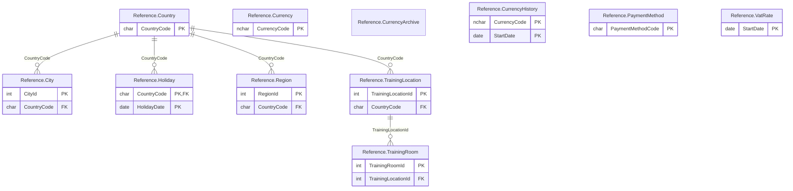

# Reference schema

The `Reference` schema has 11 tables and 37,010 rows. Back to the [schema overview](README.md).

## Entity-relationship diagram

Primary and foreign key columns only. Tables of other schemas appear when a table of this schema references them. A line is drawn from the referenced table to the referencing table: two bars mean exactly one parent, a circle and a bar mean at most one parent (nullable foreign key), and the crow's foot means any number of rows.

## Tables

### Reference.City

Cities and postal codes, 35,249 French communes plus 231 principal cities of nine other countries; several columns have deliberately imperfect types.

Rows: 35,480. Columns: 11.

| Column | Type | Nullable | Key | Default | Description |
|---|---|---|---|---|---|
| `CityId` | `int` | no | PK, identity |  | City identifier, generated automatically. |
| `RegionId` | `int` | yes |  |  | Department of the city, in Reference.Region; NULL for the foreign cities. |
| `CityName` | `varchar(255)` | yes | collation French_CI_AI |  | Name of the city. |
| `PostalCode` | `varchar(10)` | yes |  |  | Postal code stored as text; 3,130 French codes have four digits instead of five, for example 1400 instead of 01400. |
| `InseeCode` | `float` | yes |  |  | INSEE code of the commune stored as a float (1001.0), so the leading zero is lost and the type does not suit a code. |
| `RegionCode` | `float` | yes |  |  | INSEE code of the region stored as a float (82.0), with the same defect as InseeCode. |
| `Latitude` | `decimal(6,2)` | yes |  |  | Latitude in degrees, decimal(6,2), so only two decimals. |
| `Longitude` | `varchar(255)` | yes |  |  | Longitude in degrees stored as text (varchar) instead of a number; 66 values are not numeric. |
| `Distance` | `varchar(255)` | yes |  |  | Distance value stored as text, from 0.05 to 2.98 for the numeric ones; its unit is not documented and the column is NULL for 4 percent of the rows. |
| `GeoPoint` | `geography` | yes |  |  | Geography point built from Latitude and Longitude; filled for 34,317 of the 35,480 rows. |
| `CountryCode` | `char(3)` | no | FK to Reference.Country | `'FRA'` | Country, as a three-letter ISO 3166 code; FRA for the French communes. |

### Reference.Country

Countries of the world, 239 rows, with their French and English names.

Rows: 239. Columns: 5.

| Column | Type | Nullable | Key | Default | Description |
|---|---|---|---|---|---|
| `CountryCode` | `char(3)` | no | PK |  | Three-letter ISO 3166 code. |
| `FrenchName` | `varchar(50)` | no | collation French_CI_AI |  | Country name in French. |
| `EnglishName` | `varchar(50)` | no |  |  | Country name in English. |
| `Code2` | `char(2)` | no |  |  | Two-letter ISO 3166 code. |
| `Capital` | `varchar(50)` | yes |  |  | Capital city; NULL for 20 countries. |

### Reference.Currency

Currencies, 5 rows: EUR, USD, CHF, GBP and FRF; a demonstration table for the trigger chapter.

Rows: 5. Columns: 2.

| Column | Type | Nullable | Key | Default | Description |
|---|---|---|---|---|---|
| `CurrencyCode` | `nchar(3)` | no | PK |  | ISO 4217 currency code. |
| `Name` | `nvarchar(50)` | no |  |  | Currency name in English, such as Euro or Swiss franc. |

### Reference.CurrencyArchive

Archive of deleted currencies, filled by a trigger in the demonstrations; empty in the delivered database.

Rows: 0. Columns: 3.

| Column | Type | Nullable | Key | Default | Description |
|---|---|---|---|---|---|
| `CurrencyCode` | `nchar(3)` | no |  |  | ISO 4217 code of the deleted currency. |
| `Name` | `nvarchar(50)` | no |  |  | Name of the deleted currency. |
| `DeletionDate` | `datetime2(0)` | no |  |  | Date and time of the deletion. |

### Reference.CurrencyHistory

Exchange rates by period, 3 rows (USD for 2024 and 2025, CHF for 2024); a demonstration table for checking that periods do not overlap.

Rows: 3. Columns: 4.

| Column | Type | Nullable | Key | Default | Description |
|---|---|---|---|---|---|
| `CurrencyCode` | `nchar(3)` | no | PK |  | ISO 4217 currency code; first part of the primary key. |
| `StartDate` | `date` | no | PK |  | First day the rate applies; second part of the primary key. |
| `EndDate` | `date` | no |  |  | Last day the rate applies. |
| `Rate` | `decimal(12,6)` | no |  |  | Exchange rate with 6 decimals (1.085 for USD in 2024); the base currency is not documented, the values suggest units of currency per euro. |

### Reference.Holiday

National public holidays from 2010 to 2028 for France, Belgium, Switzerland, Germany and Italy, about 950 rows; sessions are not scheduled on them.

Rows: 949. Columns: 3.

| Column | Type | Nullable | Key | Default | Description |
|---|---|---|---|---|---|
| `CountryCode` | `char(3)` | no | PK, FK to Reference.Country |  | Country, as a three-letter ISO 3166 code; first part of the primary key. |
| `HolidayDate` | `date` | no | PK |  | Date of the holiday; second part of the primary key. |
| `Label` | `varchar(50)` | no |  |  | Name of the holiday, in English, such as New Year's Day or Easter Monday. |

### Reference.PaymentMethod

Reference table of payment methods, 5 rows.

Rows: 5. Columns: 2.

| Column | Type | Nullable | Key | Default | Description |
|---|---|---|---|---|---|
| `PaymentMethodCode` | `char(8)` | no | PK |  | Payment method code: CARD, CHECK, CASH, WIRE or DEBIT; stored as char(8), so the value is padded with spaces. |
| `Label` | `varchar(64)` | no | collation French_CI_AI |  | Display name of the payment method, such as Wire transfer. |

### Reference.Region

The 96 departments of metropolitan France with their region, prefecture and boundaries; despite its name, it holds one row per department.

Rows: 96. Columns: 16.

| Column | Type | Nullable | Key | Default | Description |
|---|---|---|---|---|---|
| `RegionId` | `int` | no | PK, identity |  | Row identifier, generated automatically. |
| `CountryCode` | `char(3)` | no | FK to Reference.Country |  | Country; the value is FRA on every row. |
| `RegionType` | `varchar(20)` | yes |  |  | Type of subdivision; the value is Department on every row. |
| `RegionCode` | `varchar(10)` | yes |  |  | Code of the department in a GADM style, such as FR.AI for Ain. |
| `Name` | `varchar(50)` | no | collation French_CI_AI |  | Name of the region the department belongs to (the regions before the 2016 merger). |
| `SeatCode` | `char(3)` | yes |  |  | Code of the prefecture, on three digits. |
| `SeatName` | `varchar(50)` | yes | collation French_CI_AI |  | Name of the prefecture, in capital letters. |
| `SeatX` | `smallint` | yes |  |  | X coordinate of the prefecture in a projected map system whose unit is not documented, from 1202 to 11834. |
| `SeatY` | `smallint` | yes |  |  | Y coordinate of the prefecture, in the same system as SeatX. |
| `CentroidX` | `smallint` | yes |  |  | X coordinate of the centroid of the department, in the same system as SeatX. |
| `CentroidY` | `smallint` | yes |  |  | Y coordinate of the centroid of the department, in the same system as SeatX. |
| `DepartmentCode` | `char(2)` | yes |  |  | Department number on two characters, such as 01 or 2A. |
| `DepartmentName` | `varchar(50)` | yes | collation French_CI_AI |  | Name of the department. |
| `GadmFra2Geography` | `geography` | yes |  |  | Boundary of the department as a geography polygon. |
| `Geometry` | `geometry` | yes |  |  | Boundary of the department as a geometry polygon. |
| `DepartmentVariants` | `xml` | yes |  |  | XML element with a former name of the department, for example one that was renamed; set for 19 departments. |

### Reference.TrainingLocation

Places where sessions are held, 43 rows: 26 Pacha centers, partner venues, and the virtual classroom, in France, Switzerland, Belgium, Germany and Italy.

Rows: 43. Columns: 17.

| Column | Type | Nullable | Key | Default | Description |
|---|---|---|---|---|---|
| `TrainingLocationId` | `int` | no | PK, identity |  | Location identifier, generated automatically. |
| `Name` | `varchar(50)` | yes |  |  | Name of the location, such as Centre Pacha Lille. |
| `Address1` | `varchar(40)` | yes |  |  | First address line; NULL for the virtual classroom. |
| `Address2` | `varchar(40)` | yes |  |  | Second address line; NULL for all but 6 locations. |
| `PostalCode` | `varchar(7)` | yes |  |  | Postal code, stored as text; NULL for the virtual classroom. |
| `City` | `varchar(50)` | yes |  |  | City; NULL for the virtual classroom. |
| `Metro` | `varchar(30)` | yes |  |  | Nearest metro or tram station; set for the cities that have one. |
| `Phone` | `varchar(25)` | yes |  |  | Phone number in international format. |
| `Fax` | `varchar(25)` | yes |  |  | Fax number; set for the 17 locations opened before 2015. |
| `Directions` | `varchar(255)` | yes |  |  | Address of the web page that gives directions to the location. |
| `ContactName` | `varchar(50)` | yes |  |  | Name of the contact person at the location. |
| `ContactEmail` | `varchar(200)` | yes |  |  | E-mail address of the contact person. |
| `IsPachaCenter` | `bit` | no |  | `0` | 1 for a center run by the company (26 locations), 0 for a partner venue such as a hotel or business center. |
| `CountryCode` | `char(3)` | no | FK to Reference.Country |  | Country, as a three-letter ISO 3166 code. |
| `OpeningDate` | `date` | no |  |  | Date the location opened. |
| `ClosingDate` | `date` | yes |  |  | Date the location closed; NULL for the 39 locations still open. |
| `MealFlatFee` | `decimal(5,2)` | no |  |  | Price in euros excluding VAT of the lunch supplied by the location, per learner and per day, from 0 (virtual classroom) to 42. |

### Reference.TrainingRoom

Rooms of the training locations, 187 rows with 10 to 20 seats.

Rows: 187. Columns: 8.

| Column | Type | Nullable | Key | Default | Description |
|---|---|---|---|---|---|
| `TrainingRoomId` | `int` | no | PK, identity |  | Room identifier, generated automatically. |
| `TrainingLocationId` | `int` | no | FK to Reference.TrainingLocation |  | Location of the room, in Reference.TrainingLocation. |
| `Seats` | `tinyint` | no |  | `12` | Number of seats, from 10 to 20. |
| `Name` | `varchar(20)` | yes |  |  | Room name, such as Salle Hamilton. |
| `RoomNumber` | `varchar(3)` | yes |  |  | Room number on three characters, such as 105. |
| `Corridor` | `char(1)` | yes |  |  | Corridor letter, A or B; NULL for the 8 virtual rooms. |
| `Side` | `char(1)` | yes |  |  | Side of the corridor: L (left) or R (right); NULL for the 8 virtual rooms. |
| `Floor` | `tinyint` | yes |  |  | Floor number; NULL for the 8 virtual rooms. |

### Reference.VatRate

French VAT rates by period, 3 rows.

Rows: 3. Columns: 4.

| Column | Type | Nullable | Key | Default | Description |
|---|---|---|---|---|---|
| `StartDate` | `date` | no | PK |  | First day the rates apply. |
| `EndDate` | `date` | yes |  |  | Last day the rates apply; NULL for the current period. |
| `Rate1` | `decimal(5,2)` | no |  |  | Standard VAT rate in percent: 20.6, 19.6 or 20. |
| `Rate2` | `decimal(5,2)` | yes |  |  | Reduced VAT rate in percent (5.5), kept for reference and not used. |

## Foreign keys

Indexed means that a rowstore index starts with the foreign key columns.

| Name | Table | Columns | References | Indexed |
|---|---|---|---|---|
| `fk_City_Country` | Reference.City | `CountryCode` | Reference.Country | no |
| `fk_Holiday_Country` | Reference.Holiday | `CountryCode` | Reference.Country | yes |
| `fk_Region_Country` | Reference.Region | `CountryCode` | Reference.Country | no |
| `fk_TrainingLocation_Country` | Reference.TrainingLocation | `CountryCode` | Reference.Country | no |
| `fk_TrainingRoom_TrainingLocation` | Reference.TrainingRoom | `TrainingLocationId` | Reference.TrainingLocation | no |
