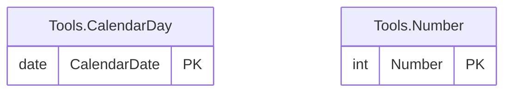

# Tools schema

The `Tools` schema has 2 tables and 50,083 rows. Back to the [schema overview](README.md).

## Entity-relationship diagram

Primary and foreign key columns only. Tables of other schemas appear when a table of this schema references them. A line is drawn from the referenced table to the referencing table: two bars mean exactly one parent, a circle and a bar mean at most one parent (nullable foreign key), and the crow's foot means any number of rows.

## Tables

### Tools.CalendarDay

Calendar table with one row per day from 1990-01-02 to 2072-02-20 (30,000 rows).

Rows: 30,000. Columns: 2.

| Column | Type | Nullable | Key | Default | Description |
|---|---|---|---|---|---|
| `CalendarDate` | `date` | no | PK |  | The day; primary key. |
| `Weekday` | `int` | yes | computed |  | Day of the week computed with DATEPART(weekday, ...), so it depends on the DATEFIRST setting; 3 for a Tuesday under the US setting (Sunday is 1). |

### Tools.Number

Numbers table of the integers from 1 to 20,083, used to generate rows.

Rows: 20,083. Columns: 1.

| Column | Type | Nullable | Key | Default | Description |
|---|---|---|---|---|---|
| `Number` | `int` | no | PK |  | Integer value; primary key. |

## Foreign keys

No table of this schema has a foreign key.
