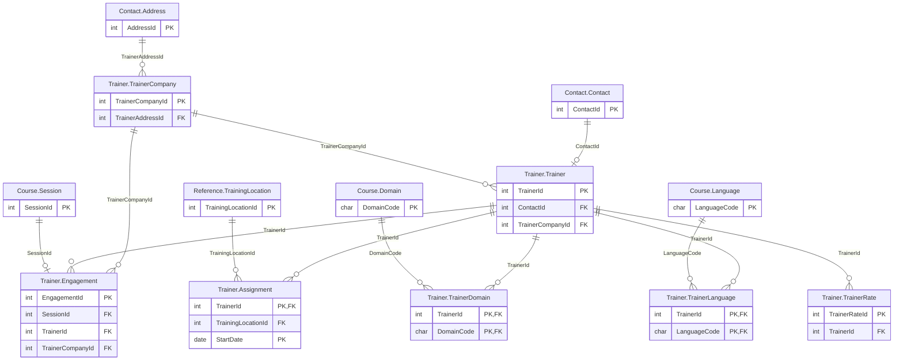

# Trainer schema

The `Trainer` schema has 7 tables and 11,460 rows. Back to the [schema overview](README.md).

## Entity-relationship diagram

Primary and foreign key columns only. Tables of other schemas appear when a table of this schema references them. A line is drawn from the referenced table to the referencing table: two bars mean exactly one parent, a circle and a bar mean at most one parent (nullable foreign key), and the crow's foot means any number of rows.

## Tables

### Trainer.Assignment

Dated assignment of a trainer to a home training center, derived from the sessions the trainer delivered in each calendar year; 605 rows.

Rows: 605. Columns: 4.

| Column | Type | Nullable | Key | Default | Description |
|---|---|---|---|---|---|
| `TrainerId` | `int` | no | PK, FK to Trainer.Trainer |  | Trainer, in Trainer.Trainer. |
| `TrainingLocationId` | `int` | no | FK to Reference.TrainingLocation |  | Home training center, in Reference.TrainingLocation. |
| `StartDate` | `date` | no | PK |  | First day of the assignment. |
| `EndDate` | `date` | yes |  |  | Last day of the assignment; NULL for the current one (70 rows). |

### Trainer.Engagement

What an independent trainer's company invoices to the company for one session delivered, one row per completed session (9,590 rows).

Rows: 9,590. Columns: 9.

| Column | Type | Nullable | Key | Default | Description |
|---|---|---|---|---|---|
| `EngagementId` | `int` | no | PK, identity |  | Engagement identifier, generated automatically. |
| `SessionId` | `int` | no | FK to Course.Session |  | Session delivered; unique, so there is one engagement per session. |
| `TrainerId` | `int` | no | FK to Trainer.Trainer |  | Trainer who delivered the session. |
| `TrainerCompanyId` | `int` | no | FK to Trainer.TrainerCompany |  | Company that invoices the engagement. |
| `InvoiceNumber` | `varchar(30)` | no |  |  | Invoice number on the trainer company's own numbering, such as 2011-001. |
| `InvoiceDate` | `date` | no |  |  | Date of the trainer's invoice, 0 to 20 days after the end of the session. |
| `DayCount` | `decimal(4,1)` | no |  |  | Billed days: the session length, plus half a day of preparation when the trainer teaches the course for the first time (1.0 to 5.5). |
| `DailyRate` | `decimal(6,2)` | no |  |  | Daily rate in euros, taken from the trainer's rate for that year (571 to 1,200). |
| `TravelExpenses` | `decimal(7,2)` | no |  |  | Travel expenses in euros: 0 for the virtual classroom or the trainer's home center, 120 elsewhere in the same country, 350 abroad. |

### Trainer.Trainer

Trainers who deliver sessions, 80 rows of which 43 are independent and 37 are employees.

Rows: 80. Columns: 12.

| Column | Type | Nullable | Key | Default | Description |
|---|---|---|---|---|---|
| `TrainerId` | `int` | no | PK, identity |  | Trainer identifier, generated automatically. |
| `SocialSecurityNumber` | `varchar(18)` | yes |  |  | Social security number; NULL on every row. |
| `Status` | `char(1)` | yes |  |  | Status code: I (independent) or E (employee). |
| `Comments` | `varchar(1000)` | yes |  |  | Free text comments; NULL on every row. |
| `DoNotContact` | `bit` | no |  |  | 1 when the trainer must not be contacted (5 trainers). |
| `Cv` | `bit` | yes |  |  | 1 when a CV is on file; 1 on every row. |
| `CreationDate` | `date` | no |  | `getdate()` | Date the row was created. |
| `CreationUser` | `varchar(128)` | no |  | `suser_sname()` | Login that created the row, in the form DOMAIN\user. |
| `ContactId` | `int` | no | FK to Contact.Contact |  | Contact record of the trainer, in Contact.Contact. |
| `TrainerCompanyId` | `int` | no | FK to Trainer.TrainerCompany | `4` | Company that employs the trainer or invoices for the trainer, in Trainer.TrainerCompany. |
| `ArrivalDate` | `date` | no |  |  | Date the trainer started delivering sessions. |
| `DepartureDate` | `date` | yes |  |  | Date the trainer stopped delivering sessions; NULL for trainers still active. |

### Trainer.TrainerCompany

Companies through which trainers are employed or invoice, 43 rows.

Rows: 43. Columns: 10.

| Column | Type | Nullable | Key | Default | Description |
|---|---|---|---|---|---|
| `TrainerCompanyId` | `int` | no | PK, identity |  | Trainer company identifier, generated automatically. |
| `Name` | `varchar(50)` | no |  |  | Company name. |
| `TrainerAddressId` | `int` | no | FK to Contact.Address |  | Postal address, in Contact.Address. |
| `CompanyPhone` | `varchar(30)` | yes |  |  | Company phone number. |
| `AdministrativePhone` | `varchar(30)` | yes |  |  | Administrative phone number; NULL on every row. |
| `Fax` | `varchar(30)` | yes |  |  | Fax number; NULL on every row. |
| `ContactName` | `varchar(150)` | yes |  |  | Name of the contact person. |
| `Comments` | `varchar(1000)` | yes |  |  | Free text comments; NULL on every row. |
| `Status` | `char(1)` | yes |  |  | Status code; the value is E on every row, including the companies of independent trainers, which looks inconsistent with Trainer.Status. |
| `ContactEmail` | `varchar(150)` | yes |  |  | E-mail address of the contact person; NULL for 5 companies. |

### Trainer.TrainerDomain

Domains a trainer can teach, one or two per trainer.

Rows: 118. Columns: 2.

| Column | Type | Nullable | Key | Default | Description |
|---|---|---|---|---|---|
| `TrainerId` | `int` | no | PK, FK to Trainer.Trainer |  | Trainer, in Trainer.Trainer. |
| `DomainCode` | `char(2)` | no | PK, FK to Course.Domain |  | Domain code, in Course.Domain: DB, BI, DV, CL, SC, AI, MG, CO or PM. |

### Trainer.TrainerLanguage

Languages a trainer can teach in; every trainer speaks FR, 30 also EN, 6 DE and 4 IT.

Rows: 120. Columns: 2.

| Column | Type | Nullable | Key | Default | Description |
|---|---|---|---|---|---|
| `TrainerId` | `int` | no | PK, FK to Trainer.Trainer |  | Trainer, in Trainer.Trainer. |
| `LanguageCode` | `char(2)` | no | PK, FK to Course.Language |  | Language code, in Course.Language: FR, EN, DE or IT. |

### Trainer.TrainerRate

Daily rate of a trainer by period, one row per trainer and year of activity (904 rows).

Rows: 904. Columns: 5.

| Column | Type | Nullable | Key | Default | Description |
|---|---|---|---|---|---|
| `TrainerRateId` | `int` | no | PK, identity |  | Rate identifier, generated automatically. |
| `TrainerId` | `int` | no | FK to Trainer.Trainer |  | Trainer, in Trainer.Trainer. |
| `StartDate` | `date` | no |  |  | First day the rate applies. |
| `EndDate` | `date` | yes |  |  | Last day the rate applies; NULL for the current rate. |
| `DailyRate` | `decimal(6,2)` | no |  |  | Daily rate in euros, from 452 to 1,200. |

## Foreign keys

Indexed means that a rowstore index starts with the foreign key columns.

| Name | Table | Columns | References | Indexed |
|---|---|---|---|---|
| `fk_Assignment_Location` | Trainer.Assignment | `TrainingLocationId` | Reference.TrainingLocation | no |
| `fk_Assignment_Trainer` | Trainer.Assignment | `TrainerId` | Trainer.Trainer | yes |
| `fk_Engagement_Session` | Trainer.Engagement | `SessionId` | Course.Session | yes |
| `fk_Engagement_Trainer` | Trainer.Engagement | `TrainerId` | Trainer.Trainer | no |
| `fk_Engagement_TrainerCompany` | Trainer.Engagement | `TrainerCompanyId` | Trainer.TrainerCompany | yes |
| `fk$Trainer$has$TrainerCompany` | Trainer.Trainer | `TrainerCompanyId` | Trainer.TrainerCompany | no |
| `fk_Trainer_is_ContactId` | Trainer.Trainer | `ContactId` | Contact.Contact | yes |
| `fk$TrainerCompany$has$TrainerAddress` | Trainer.TrainerCompany | `TrainerAddressId` | Contact.Address | no |
| `fk_TrainerDomain_Domain` | Trainer.TrainerDomain | `DomainCode` | Course.Domain | no |
| `fk_TrainerDomain_Trainer` | Trainer.TrainerDomain | `TrainerId` | Trainer.Trainer | yes |
| `fk_TrainerLanguage_Language` | Trainer.TrainerLanguage | `LanguageCode` | Course.Language | no |
| `fk_TrainerLanguage_Trainer` | Trainer.TrainerLanguage | `TrainerId` | Trainer.Trainer | yes |
| `fk$TrainerRate$references$Trainer` | Trainer.TrainerRate | `TrainerId` | Trainer.Trainer | no |
