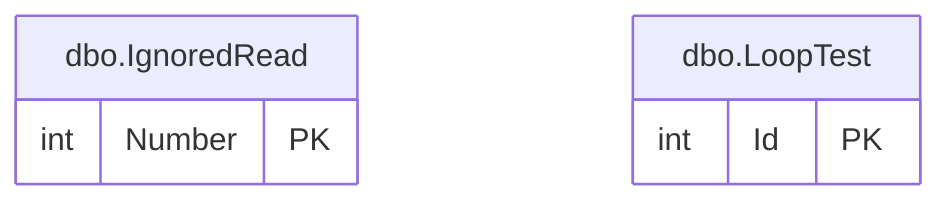

# dbo schema

The `dbo` schema has 2 tables and 50 rows. Back to the [schema overview](README.md).

## Entity-relationship diagram

Primary and foreign key columns only. Tables of other schemas appear when a table of this schema references them. A line is drawn from the referenced table to the referencing table: two bars mean exactly one parent, a circle and a bar mean at most one parent (nullable foreign key), and the crow's foot means any number of rows.

## Tables

### dbo.IgnoredRead

Demonstration table of five rows (1 to 5), used to show the READPAST locking hint.

Rows: 5. Columns: 1.

| Column | Type | Nullable | Key | Default | Description |
|---|---|---|---|---|---|
| `Number` | `int` | no | PK |  | Row value, from 1 to 5; primary key. |

### dbo.LoopTest

Demonstration table of 45 rows in three groups (10, 20 and 15 rows), used to number rows with an UPDATE in a loop.

Rows: 45. Columns: 3.

| Column | Type | Nullable | Key | Default | Description |
|---|---|---|---|---|---|
| `Id` | `int` | no | PK, identity |  | Row identifier, generated automatically. |
| `Number` | `int` | yes |  |  | Number assigned by the demonstration; NULL on every row until the demonstration runs. |
| `GroupId` | `int` | no |  |  | Group of the row: 1, 2 or 3. |

## Foreign keys

No table of this schema has a foreign key.
